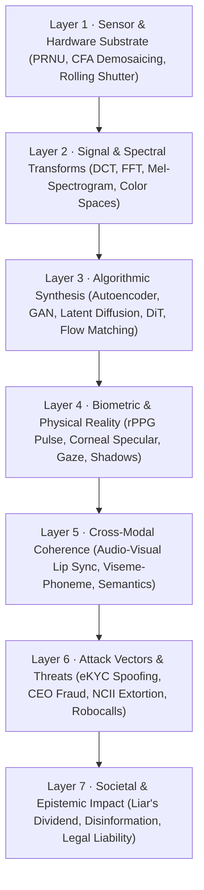
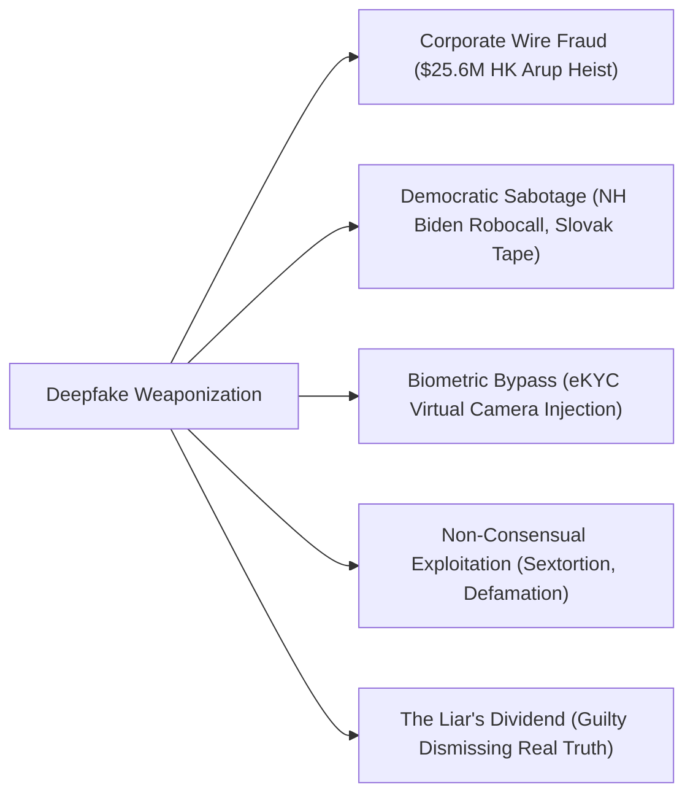
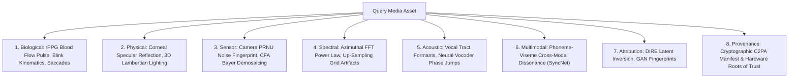

# Deepfake Research Collective — Global Deepfake Research Hub

<div align="center">

**The definitive, all-encompassing research repository and knowledge hub for synthetic media: generative creation technologies, multi-layer forensic science, global threat intelligence, real-world case studies, international legal frameworks, cryptographic provenance (C2PA), behavioral psychology, defense incident playbooks, and forensic literature synthesis.**

[](LICENSE)
[]()
[-0ea5e9?style=flat-square)](research/papers/PAPERS_DIRECTORY.md)
[](research/watermarking_and_provenance.md)
[](research/legal_regulatory_and_policy.md)
[](https://www.python.org/)

</div>

---

## 🏛️ Master Navigation Hub

> **This repository is structured as a modular, GitHub-native research portal.** Every document is formatted for clean direct reading on GitHub, complete with mathematical equations, interactive Mermaid diagrams, verified legal citations, empirical benchmark tables, and local source links.

### 🌐 Module 1 · The Global Deepfake Research Compendium

| Research Dossier | Scope & Contents | Key Topics |
|:---|:---|:---|
| **[🧬 Master Taxonomy & Ontology](research/taxonomy_and_ontology.md)** | The definitive 7-Layer Deepfake Architectural Stack (7-DAS) | Modality taxonomy (V1–V6, A1–A4, M1–M3), threat tiers, SAL 1–4 security levels |
| **[⚙️ Generation & Synthesis Technologies](research/generation_technologies.md)** | Technical treatise on generative creation pipelines | DFL, SimSwap, LivePortrait, Sora/Kling/Wan2.1 video DiT, VALL-E, RVC, 3DGS |
| **[🔬 Multi-Layer Forensic Science](research/forensics_and_detection.md)** | Beyond black-box classifiers: physical & biological invariants | rPPG blood flow pulse, corneal reflection, 3D Lambertian lighting, PRNU, CFA, DIRE |
| **[🚨 Threat Matrix & Incident Case Studies](research/threat_matrix_and_case_studies.md)** | Investigative dossier on real-world weaponization | $25.6M HK Arup heist, NH Biden robocall, Slovakia election, Gabon coup, NCII |
| **[⚖️ Legal, Regulatory & Policy Compendium](research/legal_regulatory_and_policy.md)** | Global legislative, criminal, civil, and copyright frameworks | US DEFIANCE Act, NO FAKES, FCC robocalls, CA AB 2655, TN ELVIS, EU AI Act, CAC |
| **[🔐 Cryptographic Provenance & Watermarking](research/watermarking_and_provenance.md)** | Active authenticity standards and defensive immunizations | C2PA architecture, Leica/Sony/Canon hardware keys, SynthID, PhotoGuard cloaking |
| **[🧠 Psychology, Perception & Epistemic Impact](research/psychology_and_societal_impact.md)** | Human cognitive vulnerability and societal consequences | 53.5% human detection failure, AI hyperrealism, Truth-Default theory, SIFT prebunking |
| **[🛡️ Defense Playbooks & Incident Response](research/defense_playbooks_and_incident_response.md)** | Actionable SOPs for enterprises, journalists, and victims | Real-time video 90° turn test, virtual camera blocking, StopNCII.org workflow |
| **[🗂️ Global Tools & Platforms Directory](research/deepfake_tools_directory.md)** | Exhaustive catalog of tools, services, and benchmarks | Open-source generators, forensic toolkits, commercial platforms, datasets |

---

### 🧪 Module 2 · Technical Forensics & Machine Learning Literature

| Technical Document | Scope & Contents | Key Highlights |
|:---|:---|:---|
| **[📚 Literature Review](research/literature_review.md)** | 53 verified academic papers across 8 forensic domains | CVPR, ICCV, ECCV, NeurIPS, Interspeech, ICASSP coverage |
| **[📂 Papers Directory & Local PDF Archive](research/papers/PAPERS_DIRECTORY.md)** | Annotated catalog with direct links and local full-text PDFs | 53 local PDFs (~211.5 MB) organized by forensic domain |
| **[🎯 Research Gaps & Hypotheses](research/research_gaps.md)** | 5 formal research gaps and H1–H4 falsifiable hypotheses | JPEG frequency collapse, audio codec collapse, modality absence |
| **[🏗️ Model Comparison Matrix](research/model_comparison.md)** | 12 candidate architectures evaluated | VRAM footprint, latency, and real-time execution matrix |
| **[📊 Dataset Analysis & Protocols](research/dataset_analysis.md)** | 11 benchmark datasets analyzed | Zero-leakage partition protocols, storage budgets, diversity audits |
| **[📋 Side-by-Side Invariance Matrix](research/paper_comparison.md)** | Cross-generator and cross-codec invariance comparison | Compression tolerance, latency, and vulnerability breakdown |

---

## 🧭 The 7-Layer Deepfake Architectural Stack (7-DAS)

To analyze the deepfake phenomenon holistically — from raw silicon physics up to geopolitics — this repository establishes the **7-Layer Deepfake Architectural Stack**:



---

## 🚨 The Deepfake Threat Landscape & Real-World Incident Case Studies

Synthetic media has transitioned into an active weapon utilized across cybercrime, corporate fraud, political sabotage, and personal extortion.



### Milestone Real-World Case Studies Analyzed in Depth:
1. **The $25.6 Million Hong Kong Multinational CFO Heist (Arup Case, 2024):** A finance employee was deceived into transferring $25.6M after attending a live video conference where all other participants were deepfake video/audio replicas of London executives. → [Full Case Study](research/threat_matrix_and_case_studies.md#case-study-1-the-256-million-hong-kong-multinational-cfo-heist-arup-case-2024)
2. **The New Hampshire Presidential Primary Joe Biden Robocall (2024):** Cloned audio of President Biden deployed to 25,000 voters urging them not to vote; led to felony indictments, a $6M FCC fine, and federal bans on AI robocalls. → [Full Case Study](research/threat_matrix_and_case_studies.md#case-study-2-the-new-hampshire-presidential-primary-joe-biden-robocall-2024)
3. **The Slovakian Election Eve Deepfake Audio (2023):** Fabricated audio tape released during the legal 48-hour pre-vote blackout window tipping a national parliamentary election. → [Full Case Study](research/threat_matrix_and_case_studies.md#case-study-3-the-slovakian-parliamentary-election-eve-deepfake-september-2023)
4. **The Gabon Coup Attempt & The Liar's Dividend (2018–2019):** Suspicion that an authentic presidential video was an AI deepfake triggered an armed military coup d'état. → [Full Case Study](research/threat_matrix_and_case_studies.md#case-study-4-the-gabon-president-ali-bongo-stroke-reenactment--military-coup-20182019)
5. **The Global NCII Crisis & Sextortion Epidemic:** Examining technological and legal mechanisms to combat non-consensual exploitation. → [Full Case Study](research/threat_matrix_and_case_studies.md#case-study-7-non-consensual-intimate-imagery-ncii--mass-exploitation)

---

## ⚖️ Global Legal & Policy Landscape

Governments worldwide have enacted landmark legislation to criminalize, penalize, and regulate synthetic media:

```
┌─────────────────────────────────────────────────────────────────────────────────┐
│                      GLOBAL DEEPFAKE REGULATORY COMPARISON                      │
├────────────────────┬────────────────────────────────────┬───────────────────────┤
│ Jurisdiction       │ Primary Statutes & Mandates        │ Maximum Penalty       │
├────────────────────┼────────────────────────────────────┼───────────────────────┤
│ United States      │ • DEFIANCE Act of 2024 (S. 3696)   │ $150,000 per violation│
│                    │ • NO FAKES Act (Federal likeness)  │ $6,000,000 FCC fine   │
│                    │ • FCC TCPA Ruling (Robocalls)      │ Felony criminal charges│
│                    │ • California AB 2655, SB 942       │                       │
│                    │ • Tennessee ELVIS Act (Voice IP)   │                       │
├────────────────────┼────────────────────────────────────┼───────────────────────┤
│ European Union     │ • EU AI Act (Regulation 2024/1689) │ €35M or 7% of global  │
│                    │   Article 50 (Mandatory labeling)  │ annual turnover       │
│                    │   Article 5 (Prohibited practices) │                       │
│                    │ • Digital Services Act (DSA)       │                       │
├────────────────────┼────────────────────────────────────┼───────────────────────┤
│ China              │ • CAC Deep Synthesis Provisions    │ Service shutdown,     │
│                    │ • Generative AI Interim Measures   │ algorithmic registry  │
│                    │   (Mandatory real-name & watermark)│ revocation, detention │
├────────────────────┼────────────────────────────────────┼───────────────────────┤
│ United Kingdom     │ • Online Safety Act 2023           │ 2 years imprisonment  │
├────────────────────┼────────────────────────────────────┼───────────────────────┤
│ South Korea        │ • Sexual Violence Punishment Act   │ 5 to 7 years prison   │
└────────────────────┴────────────────────────────────────┴───────────────────────┘
```

→ [Read the full Legal, Regulatory & Policy Compendium](research/legal_regulatory_and_policy.md)

---

## 🔬 Multi-Layer Forensic Defense Spectrum

Deepfake detection is not merely training a convolutional neural network on face crops. A robust forensic architecture inspects **immutable physical, biological, and sensor-level invariants**:



→ [Read the complete Multi-Layer Forensic Science Treatise](research/forensics_and_detection.md)

---

## 🛡️ Enterprise, Journalist & Victim Defense Playbooks

Actionable standard operating procedures (SOPs) ready for operational deployment:
- **Enterprise Anti-Impersonation SOP:** Real-time video conferencing challenge-response procedures:
  - **The 90-Degree Turn Test:** Forces extreme profile yaw where 2D face-swap landmark tracking collapses.
  - **Hand Occlusion Sweep:** Waving fingers across the face breaks generative inpainting models, causing severe warping.
  - **Dynamic Unscripted Dialogue:** Bypasses scripted voice conversion soundboards.
  - **Anti-Injection:** Blocking virtual camera loopbacks (`v4l2loopback`, `OBS-VirtualCam`).
- **Journalist 6-Stage Forensic Verification Protocol:** Ingestion hashing → Reverse search → Compression ELA → Biological/corneal checks → Audio spectrograms → Tool corroboration.
- **Victim Protection & NCII Emergency Response:** Chain-of-custody evidence preservation, **[StopNCII.org](https://stopncii.org)** and **[Take It Down](https://takeitdown.ncmec.org)** cryptographic hash submission, and formal DEFIANCE Act platform takedown notices.

→ [Read the complete Defense Playbooks & Incident Response SOPs](research/defense_playbooks_and_incident_response.md)

---

## 🗃️ Repository Structure

```
deepfake/
├── README.md                                  ← Primary Navigation Hub (You Are Here)
├── LICENSE                                    ← MIT License
├── requirements.txt                           ← Research & PDF Processing Dependencies
│
└── research/                                  ← Comprehensive Deepfake Research Compendium
    ├── taxonomy_and_ontology.md               ← Master 7-layer stack, modality & threat taxonomy
    ├── generation_technologies.md             ← Creation mechanisms: DFL, LivePortrait, DiT, VALL-E, RVC
    ├── forensics_and_detection.md             ← Forensic science: rPPG, corneal, PRNU, CFA, DIRE
    ├── threat_matrix_and_case_studies.md      ← Real-world incidents ($25.6M heist, Biden robocall, coups)
    ├── legal_regulatory_and_policy.md         ← Global laws: DEFIANCE Act, EU AI Act, CAC, ELVIS Act
    ├── watermarking_and_provenance.md         ← C2PA standard, hardware trust, SynthID, PhotoGuard
    ├── psychology_and_societal_impact.md      ← Human detection failure, AI hyperrealism, SIFT method
    ├── defense_playbooks_and_incident_response.md ← Enterprise, journalist, and victim SOPs
    ├── deepfake_tools_directory.md            ← Comprehensive directory of tools, engines & benchmarks
    ├── literature_review.md                   ← 53 academic papers synthesized across 8 domains
    ├── research_gaps.md                       ← H1–H4 formal hypotheses & experimental designs
    ├── model_comparison.md                    ← 12 candidate architectures (VRAM/latency matrix)
    ├── dataset_analysis.md                    ← 11 benchmark datasets with zero-leakage protocols
    ├── paper_comparison.md                    ← Invariance & limitation side-by-side matrix
    ├── update_registry.py                     ← Literature catalog compilation tool
    ├── compile_papers_metadata.py             ← Paper metadata extractor
    ├── download_expanded_papers.py            ← Full-text PDF retrieval engine
    ├── papers_data_compiled.json              ← Canonical structured paper database
    └── papers/
        ├── PAPERS_DIRECTORY.md                ← Full annotated catalog of all 53 papers
        ├── papers_catalog.json                ← Machine-readable catalog
        └── pdfs/                              ← 53 locally archived full-text PDFs (~211.5 MB)
```

---

## ⚡ Quickstart

```bash
# Clone repository
git clone https://github.com/Omnifex-Agency/deepfake.git
cd deepfake

# Install research & parsing dependencies
pip install -r requirements.txt

# Verify and update the local literature catalog
python research/update_registry.py
```

---

## 📖 Citation

If you utilize this research compendium or literature catalog in your scholarly research, please cite:

```bibtex
@article{deepfake_research_collective_2026,
  author    = {Deepfake Research Collective},
  title     = {The Comprehensive Deepfake Compendium: Generative Architectures, Multi-Layer
               Forensics, Threat Intelligence, Legal Governance, and Provenance Standards},
  journal   = {Global Deepfake Research Initiative / Working Research Compendium},
  year      = {2026},
  url       = {https://github.com/Omnifex-Agency/deepfake}
}
```

---

## 📄 License

This research repository is released under the **[MIT License](LICENSE)**.  
Dedicated to advancing open scientific research, media authenticity, public education, and digital human rights.
