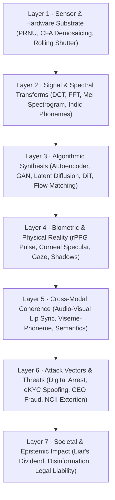
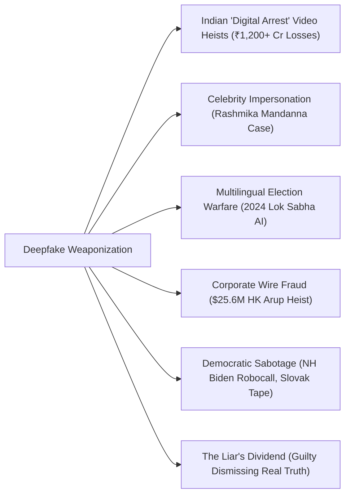
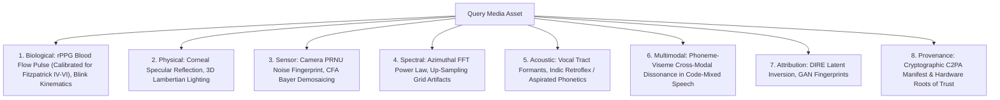
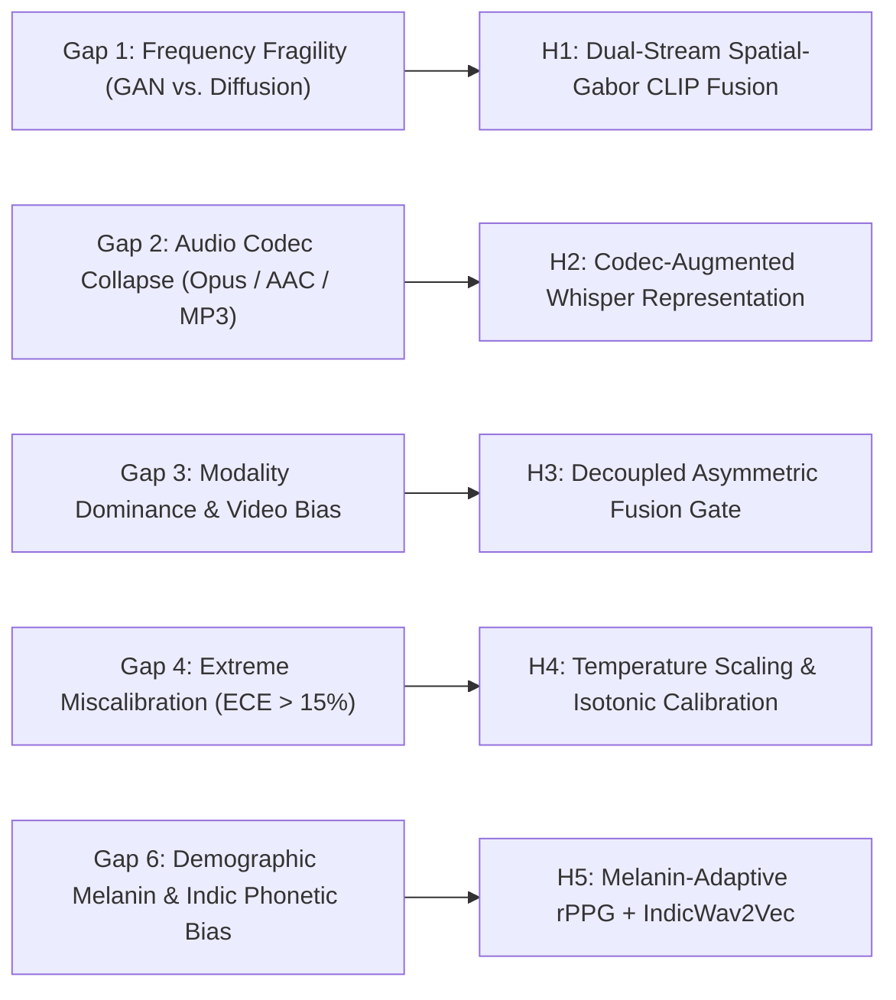

# Deepfake Research Collective — Global Deepfake Research Hub

<div align="center">

**The definitive, all-encompassing research repository and knowledge hub for synthetic media: generative creation technologies, multi-layer forensic science, global & Indian threat intelligence, real-world case studies, international statutory frameworks (IT Act / BNS / EU AI Act / DEFIANCE), cryptographic provenance (C2PA), behavioral psychology, defense incident playbooks, and forensic literature synthesis.**

[](LICENSE)
[]()
[-0ea5e9?style=flat-square)](research/papers/PAPERS_DIRECTORY.md)
[]()
[](research/06_deepfake_watermarking_and_provenance.md)
[](research/05_deepfake_legal_regulatory_and_policy.md)
[](https://www.python.org/)

</div>

---

## 🏛️ Master Navigation Hub

> **This repository is structured as a modular, GitHub-native research portal.** Every document is formatted for clean direct reading on GitHub, complete with mathematical equations, interactive Mermaid diagrams, verified statutory citations, empirical benchmark tables, and local source links.

### 🌐 Module 1 · The Global Deepfake Research Compendium

| Document | Scope & Contents | Key Topics |
|:---|:---|:---|
| **[01 · 🧬 Taxonomy & Ontology](research/01_deepfake_taxonomy_and_ontology.md)** | The definitive 7-Layer Deepfake Architectural Stack (7-DAS) & Demographic Framework | Modality taxonomy (V1–V6, A1–A4, M1–M3), threat tiers, SAL 1–4, and **Indian Phenotypic/Linguistic Dynamics** |
| **[02 · ⚙️ Generation Technologies](research/02_deepfake_generation_technologies.md)** | Technical treatise on generative creation pipelines | DFL, SimSwap, LivePortrait, Sora/Kling/Wan2.1 video DiT, VALL-E, RVC, 3DGS |
| **[03 · 🔬 Multi-Layer Forensic Science](research/03_deepfake_forensics_and_detection.md)** | Beyond black-box classifiers: physical & biological invariants | rPPG blood flow pulse, corneal reflection, 3D Lambertian lighting, PRNU, CFA, DIRE |
| **[04 · 🚨 Threat Matrix & Case Studies](research/04_deepfake_threat_matrix_and_case_studies.md)** | Real-world weaponization dossier: global & Indian incidents | $25.6M HK Arup heist, **Rashmika Mandanna viral deepfake & IFSO arrest**, **2024 Lok Sabha AI elections**, **Digital Arrest scams**, **Tamil Nadu posthumous AI** |
| **[05 · ⚖️ Legal & Policy Compendium](research/05_deepfake_legal_regulatory_and_policy.md)** | International & Indian statutory, criminal, civil, and IP frameworks | **India IT Act (Sec 66D/66E), IT Rules 2021 (24h takedown), BNS 2023, DPDP Act 2023, Delhi HC Personality Rights (Anil Kapoor/Amitabh Bachchan)**, US DEFIANCE Act, EU AI Act |
| **[06 · 🔐 Provenance & Watermarking](research/06_deepfake_watermarking_and_provenance.md)** | Active authenticity standards and defensive immunizations | C2PA architecture, Leica/Sony/Canon hardware keys, SynthID, PhotoGuard cloaking |
| **[07 · 🧠 Psychology & Societal Impact](research/07_deepfake_psychology_and_societal_impact.md)** | Human cognitive vulnerability and societal consequences | 53.5% human detection failure, AI hyperrealism, Truth-Default theory, SIFT prebunking, WhatsApp forward virality |
| **[08 · 🛡️ Defense Incident Playbooks](research/08_deepfake_defense_playbooks_and_incident_response.md)** | Actionable SOPs for enterprises, journalists, and victims | **Indian Cybercrime Portal (cybercrime.gov.in), 1930 Helpline, DoT Chakshu/Sanchar Saathi**, 90° video turn test, StopNCII.org workflow |
| **[09 · 🗂️ Tools & Platforms Directory](research/09_deepfake_tools_and_platforms_directory.md)** | Exhaustive catalog of tools, services, and benchmarks | **IndiFake, Bhashini IndicSpeech, IIT Jodhpur IAB Lab, IIT Ropar**, DeepfakeBench, commercial platforms |

---

### 🧪 Module 2 · Technical Forensics & Machine Learning Literature

| Document | Scope & Contents | Key Highlights |
|:---|:---|:---|
| **[10 · 📚 Literature Review](research/10_deepfake_literature_review.md)** | 78 verified academic papers synthesized across 11 scientific domains | CVPR, ICCV, ECCV, NeurIPS, PNAS, Interspeech, ICASSP, IEEE T-BIOM coverage |
| **[📂 Papers Directory & Catalog](research/papers/PAPERS_DIRECTORY.md)** | Annotated catalog with direct links, metrics, and local PDF endpoints | 78 papers cataloged across 11 specialized categories |
| **[11 · 🎯 Research Gaps & Hypotheses](research/11_deepfake_research_gaps.md)** | 6 formal research gaps and H1–H5 falsifiable hypotheses | Frequency degradation, audio codec collapse, modality dominance, calibration, and Indic demographic bias |
| **[12 · 🏗️ Model Comparison Matrix](research/12_deepfake_model_comparison.md)** | 12 candidate architectures evaluated | VRAM footprint, latency, and real-time execution matrix |
| **[13 · 📊 Dataset Analysis & Protocols](research/13_deepfake_dataset_analysis.md)** | 11 benchmark datasets + **Indian & South Asian Representation Analysis** | Zero-leakage partition protocols, **Fitzpatrick IV–VI melanin rPPG bias, Indic speech phonetics** |
| **[14 · 📋 Side-by-Side Invariance Matrix](research/14_deepfake_paper_comparison.md)** | Cross-generator and cross-codec invariance comparison | Compression tolerance, latency, and vulnerability breakdown |

---

## 🧭 The 7-Layer Deepfake Architectural Stack (7-DAS)

To analyze the deepfake phenomenon holistically — from raw silicon physics up to geopolitics and cultural virality — this repository establishes the **7-Layer Deepfake Architectural Stack**:



---

## 🚨 The Deepfake Threat Landscape & Milestone Case Studies

Synthetic media has transitioned into an active weapon utilized across cybercrime, corporate fraud, political sabotage, and personal extortion.



### Milestone Case Studies Analyzed in Depth:
1. **The Rashmika Mandanna Deepfake & Delhi Police IFSO Cyber Arrest (India, 2023–2024):** A viral face-swap video sparked national outrage, leading to landmark MeitY statutory advisories to platforms under Rule 3(1)(b) of the IT Rules and the arrest of the creator in Andhra Pradesh. → [Full Case Study](research/04_deepfake_threat_matrix_and_case_studies.md#case-study-8-the-rashmika-mandanna-viral-deepfake--delhi-police-ifso-arrest-india-20232024)
2. **The 2024 Indian Lok Sabha General Elections (World's First Multilingual AI Election):** Dual-use deployment of generative AI: official speech translation into regional languages via Bhashini vs. malicious forgeries depicting Bollywood stars Aamir Khan and Ranveer Singh endorsing political parties. → [Full Case Study](research/04_deepfake_threat_matrix_and_case_studies.md#case-study-9-the-2024-indian-lok-sabha-general-elections-worlds-first-multilingual-ai-election)
3. **The "Digital Arrest" Cybercrime Epidemic across India (2023–2026):** Syndicates deploying deepfake uniformed IPS officers and CBI inspectors on Skype/WhatsApp video calls with forged Supreme Court warrants, extorting over ₹1,200 Crores from citizens. → [Full Case Study](research/04_deepfake_threat_matrix_and_case_studies.md#case-study-10-the-digital-arrest-cybercrime-epidemic-across-india-20232026)
4. **Posthumous AI Political Reincarnation in Tamil Nadu (2024):** Synthesized AI avatars and cloned voices of deceased Dravidian icons M. Karunanidhi and J. Jayalalithaa utilized in state campaign rallies. → [Full Case Study](research/04_deepfake_threat_matrix_and_case_studies.md#case-study-11-posthumous-ai-political-reincarnation-in-tamil-nadu-2024)
5. **The $25.6 Million Hong Kong Multinational CFO Heist (Arup Case, 2024):** A finance employee was deceived into transferring $25.6M after attending a live video conference where all other participants were deepfake video/audio replicas of London executives. → [Full Case Study](research/04_deepfake_threat_matrix_and_case_studies.md#case-study-1-the-256-million-hong-kong-multinational-cfo-heist-arup-case-2024)
6. **The New Hampshire Presidential Primary Joe Biden Robocall (2024):** Cloned audio of President Biden deployed to 25,000 voters urging them not to vote; led to felony indictments and a $6M FCC fine. → [Full Case Study](research/04_deepfake_threat_matrix_and_case_studies.md#case-study-2-the-new-hampshire-presidential-primary-joe-biden-robocall-2024)

---

## ⚖️ Global & Indian Legal Framework Comparison

```
┌─────────────────────────────────────────────────────────────────────────────────┐
│                      DEEPFAKE STATUTORY REGULATORY COMPARISON                   │
├────────────────────┬────────────────────────────────────┬───────────────────────┤
│ Jurisdiction       │ Primary Statutes & Mandates        │ Maximum Penalty       │
├────────────────────┼────────────────────────────────────┼───────────────────────┤
│ India              │ • IT Act, 2000 (Sec 66D, 66E, 67)  │ Up to 7 years prison  │
│                    │ • IT Intermediary Rules, 2021      │ Loss of Safe Harbor   │
│                    │   (Rule 3(2)(b) 24h Takedown)      │ ₹250 Crore penalty    │
│                    │ • Bharatiya Nyaya Sanhita (BNS)    │ (under DPDP Act)      │
│                    │   Sec 318(4), Sec 336, Sec 79      │                       │
│                    │ • Delhi HC Personality Rights      │ Omnibus Injunctions   │
│                    │   (Anil Kapoor, Amitabh Bachchan)  │                       │
├────────────────────┼────────────────────────────────────┼───────────────────────┤
│ United States      │ • DEFIANCE Act of 2024 (S. 3696)   │ $150,000 per violation│
│                    │ • NO FAKES Act (Federal likeness)  │ $6,000,000 FCC fine   │
│                    │ • FCC TCPA Ruling (Robocalls)      │ Felony criminal charges│
│                    │ • California AB 2655, SB 942       │                       │
│                    │ • Tennessee ELVIS Act (Voice IP)   │                       │
├────────────────────┼────────────────────────────────────┼───────────────────────┤
│ European Union     │ • EU AI Act (Regulation 2024/1689) │ €35M or 7% of global  │
│                    │   Article 50 (Mandatory labeling)  │ annual turnover       │
│                    │   Article 5 (Prohibited practices) │                       │
│                    │ • Digital Services Act (DSA)       │                       │
├────────────────────┼────────────────────────────────────┼───────────────────────┤
│ China              │ • CAC Deep Synthesis Provisions    │ Service shutdown,     │
│                    │ • Generative AI Interim Measures   │ algorithmic registry  │
│                    │   (Mandatory real-name & watermark)│ revocation, detention │
├────────────────────┼────────────────────────────────────┼───────────────────────┤
│ United Kingdom     │ • Online Safety Act 2023           │ 2 years imprisonment  │
└────────────────────┴────────────────────────────────────┴───────────────────────┘
```

→ [Read the full Legal, Regulatory & Policy Compendium](research/05_deepfake_legal_regulatory_and_policy.md)

---

## 🔬 Multi-Layer Forensic Defense Spectrum

Deepfake detection is not merely training a convolutional neural network on face crops. A robust forensic architecture inspects **immutable physical, biological, and sensor-level invariants**:



→ [Read the complete Multi-Layer Forensic Science Treatise](research/03_deepfake_forensics_and_detection.md)

---

## 🔬 Research Gaps, Empirical Dilemmas & Falsifiable Hypotheses

Forensic research frequently suffers from publication bias, static benchmarking, and demographic blindness. This repository synthesizes **six critical literature gaps** and formulates **five mathematically rigorous, falsifiable hypotheses** ($H_1$–$H_5$) structured with explicit disproving criteria:



### The Falsifiable Hypothesis Matrix ($H_1$–$H_5$)

| Hypothesis & Focus | Literature Gap Addressed | Technical Intervention | Falsification Criteria (Disproving Threshold) | Benchmark Datasets |
|:---|:---|:---|:---|:---|
| **$H_1$: Dual-Domain Spatial-Frequency Invariance** | **Gap 1:** Classifiers overfit to GAN grid artifacts and collapse on unseen diffusion models (DDPM/DiT). | Dual-stream network: 2D Learnable Gabor Filterbank (Branch A) + frozen CLIP ViT-L/14 patch embeddings (Branch B) with cross-attention gating. | Unseen diffusion ROC-AUC within $\pm 2\%$ of vanilla CLIP, OR $>8\%$ performance drop under JPEG compression ($Q=70$). | [FaceForensics++](https://github.com/ondyari/FaceForensics), [Celeb-DF v2](https://github.com/yuezunli/celeb-deepfakeforensics), [GenImage](https://github.com/GenImage-Dataset/GenImage) |
| **$H_2$: Codec-Augmented Audio Anti-Spoofing** | **Gap 2:** Raw waveform detectors (AASIST) experience $>20\%$ EER collapse under mobile Opus/AAC compression. | Frozen Whisper-Base encoder coupled to SpecRNet with on-the-fly stochastic codec compression (Opus 16–32k, AAC 32–64k, MP3). | Relative EER reduction on in-the-wild speech $<15\%$, OR clean ASVspoof 2019 LA evaluation degrades by $>3.0\%$ EER. | [ASVspoof 2019/2021](https://www.asvspoof.org/), [In-The-Wild Audio](https://deepfake-total.com/in_the_wild_dataset), [WaveFake](https://github.com/joel-frank/wavefake) |
| **$H_3$: Decoupled Multimodal Fusion Gate** | **Gap 3:** Concatenated multimodal systems suffer modality collapse, failing on Real-Video / Fake-Audio (RF) attacks. | Decoupled unimodal risk scores ($s_v, s_a$) combined with cross-modal temporal dissonance penalty $d_{av} = \|f_v - f_a\|_2$ and modality dropout. | Balanced accuracy on the RF quadrant of FakeAVCeleb fails to improve by at least $8\%$ over joint concatenation. | [FakeAVCeleb](https://github.com/DVoice-Lab/FakeAVCeleb), [DFDC](https://www.kaggle.com/c/deepfake-detection-challenge) |
| **$H_4$: Post-Hoc Uncertainty Calibration** | **Gap 4:** Cross-entropy trained detectors output extreme, uncalibrated probabilities ($p > 0.999$), driving false alarm rates. | Temperature Scaling and Isotonic Regression calibrated on held-out validation sets; reliability diagram verification. | Expected Calibration Error (ECE) on out-of-distribution media remains $>8\%$ after temperature scaling. | [Celeb-DF v2](https://github.com/yuezunli/celeb-deepfakeforensics), [DeepfakeBench](https://github.com/Sensity-AI/DeepfakeBench) |
| **$H_5$: Cross-Demographic & Indic Adaptation** | **Gap 6:** Western models drop 15%–22% AUC on South Asian faces (Fitzpatrick IV–VI) and collapse on Indic retroflex/aspirated speech. | Melanin-adaptive Plane-Orthogonal-to-Skin (POS) rPPG chrominance projection + cultural adornment masking + frozen IndicWav2Vec foundation features. | Equal Error Rate on IndiFake remains $>12\%$ OR speech anti-spoofing EER degrades on Indic retroflex tokens by $>4.5\%$ vs. English. | [IndiFake](https://github.com/iab-rubic/IndianDeepfakeBenchmark), [Bhashini IndicSpeech](https://bhashini.gov.in/), [IIT Jodhpur Biometrics](https://iab-rubic.github.io/) |

→ [Read the complete Research Gaps, Hypotheses & Experimental Designs Treatise](research/11_deepfake_research_gaps.md)

---

## 🛡️ Actionable Defense & Incident Response Playbooks

Standard operating procedures (SOPs) ready for operational deployment:
- **India-Specific Citizen & Enterprise SOP:**
  - **National Cyber Fraud Helpline 1930:** Immediate triggering of the CFCFRS system within the "Golden Hour" to freeze defrauded bank transfers.
  - **National Cyber Crime Reporting Portal ([cybercrime.gov.in](https://cybercrime.gov.in)):** Formal FIR registration under Sections 66D/66E IT Act and Section 318(4) BNS.
  - **DoT Chakshu & Sanchar Saathi:** Nationwide blacklisting and IMEI blocking of fraudulent calling devices.
  - **IT Rules 2021 Statutory Notice:** Enforcing mandatory 24-hour content takedown on social platforms with Grievance Appellate Committee (GAC) escalation.
- **Enterprise Anti-Impersonation SOP:** Real-time video conferencing challenge-response procedures:
  - **The 90-Degree Turn Test:** Forces extreme profile yaw where 2D face-swap landmark tracking collapses.
  - **Hand Occlusion Sweep:** Waving fingers across the face breaks generative inpainting models, causing severe warping.
  - **Dynamic Unscripted Dialogue:** Bypasses scripted voice conversion soundboards.
  - **Anti-Injection:** Blocking virtual camera loopbacks (`v4l2loopback`, `OBS-VirtualCam`).
- **Victim Protection & NCII Emergency Response:** Chain-of-custody evidence preservation, **[StopNCII.org](https://stopncii.org)** and **[Take It Down](https://takeitdown.ncmec.org)** cryptographic hash submission.

→ [Read the complete Defense Playbooks & Incident Response SOPs](research/08_deepfake_defense_playbooks_and_incident_response.md)

---

## 🗃️ Repository Structure

```
deepfake/
├── README.md                                                  ← Primary Navigation Hub (You Are Here)
├── LICENSE                                                    ← MIT License
├── requirements.txt                                           ← Research & PDF Processing Dependencies
│
└── research/                                                  ← Comprehensive Deepfake Research Compendium
    ├── 01_deepfake_taxonomy_and_ontology.md                   ← Master 7-layer stack, modality & Indian phenotypic/linguistic context
    ├── 02_deepfake_generation_technologies.md                 ← Creation mechanisms: DFL, LivePortrait, DiT, VALL-E, RVC
    ├── 03_deepfake_forensics_and_detection.md                 ← Forensic science: rPPG, corneal, PRNU, CFA, DIRE
    ├── 04_deepfake_threat_matrix_and_case_studies.md          ← Real-world incidents ($25.6M heist, Rashmika Mandanna, Digital Arrest)
    ├── 05_deepfake_legal_regulatory_and_policy.md             ← Laws: India IT Act, BNS 2023, DPDP Act, DEFIANCE Act, EU AI Act
    ├── 06_deepfake_watermarking_and_provenance.md             ← C2PA standard, hardware trust, SynthID, PhotoGuard
    ├── 07_deepfake_psychology_and_societal_impact.md          ← Human detection failure, AI hyperrealism, WhatsApp forward virality
    ├── 08_deepfake_defense_playbooks_and_incident_response.md ← Indian 1930 / cybercrime.gov.in SOPs, enterprise & victim response
    ├── 09_deepfake_tools_and_platforms_directory.md           ← Indian datasets (IndiFake, Bhashini) & global tools directory
    ├── 10_deepfake_literature_review.md                       ← 78 academic papers synthesized across 11 domains
    ├── 11_deepfake_research_gaps.md                           ← 6 formal research gaps and H1–H5 falsifiable hypotheses
    ├── 12_deepfake_model_comparison.md                        ← 12 candidate architectures (VRAM/latency matrix)
    ├── 13_deepfake_dataset_analysis.md                        ← 11 benchmark datasets + Indian & South Asian representation analysis
    ├── 14_deepfake_paper_comparison.md                        ← Invariance & limitation side-by-side matrix
    ├── update_registry.py                                     ← Literature catalog compilation tool
    ├── compile_papers_metadata.py                             ← Paper metadata extractor
    ├── download_expanded_papers.py                            ← Full-text PDF retrieval engine
    ├── papers_data_compiled.json                              ← Canonical structured paper database (78 papers)
    └── papers/
        ├── PAPERS_DIRECTORY.md                                ← Full annotated catalog of all 78 papers
        ├── papers_catalog.json                                ← Machine-readable catalog
        └── pdfs/                                              ← Locally archived full-text PDFs (~211.5 MB)
```

---

## ⚡ Quickstart

```bash
# Clone repository
git clone https://github.com/Omnifex-Agency/deepfake.git
cd deepfake

# Install research & parsing dependencies
pip install -r requirements.txt

# Verify and update the local literature catalog
python research/update_registry.py
```

---

## 📖 Citation

If you utilize this research compendium or literature catalog in your scholarly research, please cite:

```bibtex
@article{deepfake_research_collective_2026,
  author    = {Deepfake Research Collective},
  title     = {The Comprehensive Deepfake Compendium: Generative Architectures, Multi-Layer
               Forensics, Global & Indic Threat Intelligence, Statutory Governance, and Provenance Standards},
  journal   = {Global Deepfake Research Initiative / Working Research Compendium},
  year      = {2026},
  url       = {https://github.com/Omnifex-Agency/deepfake}
}
```

---

## 📄 License

This research repository is released under the **[MIT License](LICENSE)**.  
Dedicated to advancing open scientific research, media authenticity, public education, and digital human rights.
