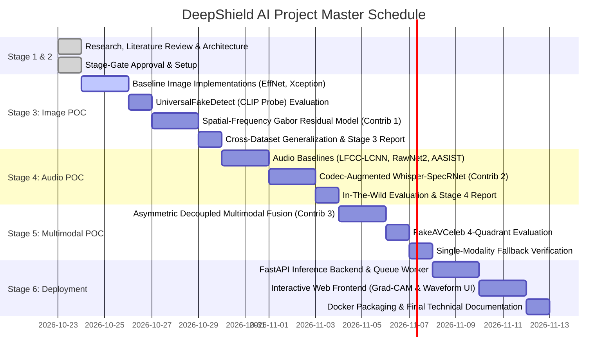

# DeepShield AI — Phased Implementation Roadmap & Governance

> **Project Roadmap, Milestones & Stage-Gate Governance**  
> **Prepared by:** AI Software Architect, Senior AI/ML Research Scientist  
> **Date:** October 2026

---

## 1. Project Stages & Stage-Gate Approval Process

---

## 2. Milestone Exit Criteria

| Stage | Milestone Deliverable | Quantifiable Exit Criteria |
| :--- | :--- | :--- |
| **Stage 1 (Research)** | Verified Literature Review & Shortlist | $\ge 25$ papers fully verified; candidate datasets and models shortlisted; hardware profiled. |
| **Stage 3 (Image POC)** | Image Detection Suite | Baseline models trained; cross-generator AUC on Celeb-DF $\ge 75\%$; calibration ECE $\le 5\%$. |
| **Stage 4 (Audio POC)** | Audio Detection Suite | AASIST and Whisper models benchmarked; In-The-Wild EER $\le 10\%$; codec robustness verified. |
| **Stage 5 (Multimodal)** | Audio-Visual Fusion Engine | FakeAVCeleb RF quadrant accuracy $\ge 85\%$; zero crash on missing modality. |
| **Stage 6 (Deployment)** | Production Application | FastAPI end-to-end latency $\le 150\text{ ms}$; responsive UI with Grad-CAM visualization. |
