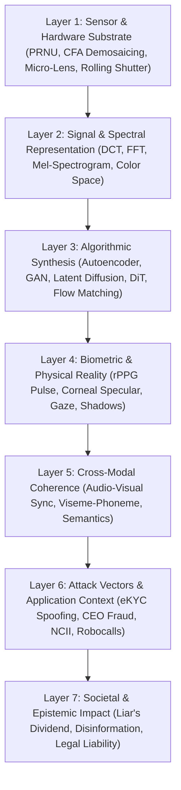
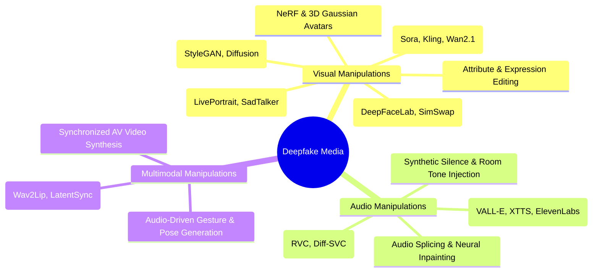

# Unified Deepfake Taxonomy & Research Ontology

<div align="center">

**A comprehensive, multi-dimensional framework categorizing generation mechanisms, forensic domains, attack surfaces, threat severity levels, and defensive perimeters.**

</div>

---

## 1. Executive Summary & Purpose

The term **"Deepfake"** (a portmanteau of *deep learning* and *fake*) has expanded far beyond its original 2017 origins (autoencoder-based face replacement in video). Today, it encompasses an entire ecosystem of generative AI manipulations spanning:
- Synthetic audio (voice cloning, text-to-speech, voice conversion)
- Synthetic imagery (GAN, Diffusion, Flow Matching)
- Synthetic video (talking head reenactment, full-body motion transfer, text-to-video world models)
- Multimodal synthetic deception (synchronized cross-modal fabrication)

This document establishes the **definitive, normalized research ontology** for deepfakes, providing an exhaustive reference schema used across academia, cybersecurity, forensic analysis, regulatory compliance, and incident response.

---

## 2. Seven-Layer Deepfake Architectural Stack (7-DAS)

To analyze any synthetic media artifact systematically, we introduce the **7-Layer Deepfake Architectural Stack (7-DAS)**:



| Layer | Name | Description | Key Forensic & Analysis Targets |
|:---|:---|:---|:---|
| **L7** | **Societal & Epistemic** | Systemic impact on democratic processes, jurisprudence, media trust | Liar's dividend, truth decay, legal admissibility, regulatory compliance |
| **L6** | **Attack Vector** | How the manipulation is delivered and monetized/weaponized | Video injection, virtual camera loopback, social engineering, extortion |
| **L5** | **Cross-Modal Coherence** | Harmony between temporal modalities (audio, visual, textual) | Lip-sync offset, viseme-phoneme dissonance, cross-modal attention |
| **L4** | **Biometric & Physical** | Compliance with fundamental laws of physics and biology | Heartbeat (rPPG), corneal reflection, 3D lighting, blink dynamics |
| **L3** | **Algorithmic Synthesis** | The deep generative network and mathematical pipeline | Latent inversion, blending borders, upsampling checkerboard, GAN noise |
| **L2** | **Signal & Spectral** | Low-level mathematical representations and transforms | High-frequency roll-off, DCT quantization ghosts, phase spectra |
| **L1** | **Sensor & Hardware** | Physical image/audio capture hardware characteristics | PRNU sensor noise, CFA demosaicing periodicity, microphone acoustic floor |

---

## 3. Modality & Manipulation Taxonomy



### 3.1 Visual Manipulations

| Class ID | Manipulation Type | Primary Mechanism | State-of-the-Art Engines | Distinguishing Characteristics |
|:---|:---|:---|:---|:---|
| **V1** | **Entire Face Synthesis** | Random unconditional or text-conditional face generation | StyleGAN3, Flux.1, Midjourney v6, SDXL | Pristine symmetry, synthetic iris patterns, background warping, missing teeth micro-detail |
| **V2** | **Identity Swap (Face Swap)** | Replacing source face onto target video body | DeepFaceLab, SimSwap, RoOP, FaceFusion, InfoSwap | Blending boundaries around face perimeter, color mismatch under changing lighting, landmark jitter |
| **V3** | **Facial Reenactment** | Transferring facial movements and expressions of actor to target | LivePortrait, FOMM, AniPortrait, Thin-Plate Spline | Eye gaze dissociation, teeth smearing, ear/jaw warping, temporal flickering |
| **V4** | **Attribute & Expression Editing** | Modifying specific features (age, gender, smile, glasses) | StarGAN v2, StyleCLIP, InstructPix2Pix | Local boundary blurring, inconsistent shadow direction, loss of micro-wrinkles |
| **V5** | **Full Video / World Generation** | End-to-end video synthesis from text/image prompt | OpenAI Sora, Kling 1.5, Runway Gen-3, Wan2.1, LTX | Physics violations, morphing limbs, object permanence failure, temporal diffusion drift |
| **V6** | **3D NeRF & Gaussian Avatars** | Neural radiance fields or 3D Gaussian splats for dynamic head reconstruction | GaussianAvatars, FlashAvatar, NeRF-Pose | View-dependent specular distortions, floating artifacts around hair/silhouette |

### 3.2 Audio Manipulations

| Class ID | Manipulation Type | Primary Mechanism | State-of-the-Art Engines | Distinguishing Characteristics |
|:---|:---|:---|:---|:---|
| **A1** | **Zero-Shot Voice Cloning (TTS)** | Text input rendered in target's voice timbre using 3-second audio prompt | VALL-E, ElevenLabs, XTTS-v2, F5-TTS, CosyVoice | Flat prosody over long sentences, unnatural micro-pauses, missing inhalation/exhalation dynamics |
| **A2** | **Voice Conversion (VC)** | Source speech audio converted to target speaker's vocal characteristics | RVC (Retrieval-based Voice Conversion), FreeVC, Diff-SVC | Pitch tracking artifacts, formant smearing, phonetic leakage from source speaker |
| **A3** | **Neural Audio Inpainting / Splicing** | Modifying specific words or phrases in authentic recording | VoiceFixer, DiffWave inpainting | Phase discontinuity at stitch points, background acoustic noise step-changes |
| **A4** | **Neural Vocoder Resynthesis** | Re-generating waveform from Mel-spectrogram | HiFi-GAN, BigVGAN, WaveGlow | High-frequency spectral truncation (>16 kHz), phase inconsistency in harmonics |

### 3.3 Multimodal Manipulations

| Class ID | Manipulation Type | Primary Mechanism | State-of-the-Art Engines | Distinguishing Characteristics |
|:---|:---|:---|:---|:---|
| **M1** | **Lip-Sync Re-Dubbing** | Synchronizing lip movements of existing video to match new audio | Wav2Lip, SyncNet-inversion, LatentSync, Hallo | Teeth blurring, rigid jaw motion, temporal latency between phoneme acoustic burst and viseme mouth shape |
| **M2** | **Cross-Modal Replacement** | Replacing authentic audio with clone, keeping original video untouched | Multimodal splicing pipeline | Phoneme-viseme mismatch, mismatched emotional affect between vocal tone and facial expression |
| **M3** | **End-to-End Multimodal Synthesis** | Simultaneous generation of coordinated video and speech | V-Express, EMO (Emote Portrait Alive) | Macro-temporal drift, lack of physiological pulse (rPPG), uniform skin reflectance |

---

## 4. Threat Actor & Motivation Taxonomy

```
┌─────────────────────────────────────────────────────────────────────────────────┐
│                           THREAT ACTOR SPECTRUM                                 │
├──────────────────────┬──────────────────────┬───────────────────────────────────┤
│ Tier                 │ Motivation           │ Capabilities & Weapons            │
├──────────────────────┼──────────────────────┼───────────────────────────────────┤
│ Tier 1: Nation-State │ Geopolitical, hybrid │ Supercomputing clusters, custom   │
│ Advanced Persistent  │ warfare, election    │ zero-day generative pipelines,    │
│ Threat (APT)         │ sabotage, statecraft │ real-time intelligence injection  │
├──────────────────────┼──────────────────────┼───────────────────────────────────┤
│ Tier 2: Transnational│ High-value fraud,    │ Commercial cloud farms, real-time │
│ Organized Crime      │ eKYC bypass, money   │ video injection tools, cloned VIP │
│ Syndicates           │ laundering           │ voices for live telephone calls   │
├──────────────────────┼──────────────────────┼───────────────────────────────────┤
│ Tier 3: Opportunistic│ Harassment, sextor-  │ Open-source repos (RoOP, RVC),    │
│ Cybercriminals &     │ tion, revenge porn,  │ Telegram bot services, automated  │
│ Harassers            │ social engineering   │ unnudification scripts            │
├──────────────────────┼──────────────────────┼───────────────────────────────────┤
│ Tier 4: Hobbyists,   │ Satire, parodies,    │ Consumer GPUs, consumer web apps  │
│ Satirists & Memers   │ creative expression  │ (Midjourney, Runway, Luma), water-│
│                      │                      │ marked outputs                    │
└──────────────────────┴──────────────────────┴───────────────────────────────────┘
```

---

## 5. Security Assurance Levels (SAL 1–4)

To systematically evaluate defenses against deepfakes, we define four **Security Assurance Levels (SAL)**:

| Level | Name | Threat Model | Required Defense Capabilities | Target Failure Rate |
|:---:|:---|:---|:---|:---:|
| **SAL-1** | **Basic Consumer Hygiene** | Compressed social media memes, consumer-grade face swaps | Standard spatial CNN or frequency detector, metadata inspection | FAR < 5%, FRR < 5% |
| **SAL-2** | **Media & Journalism Verification** | High-resolution manipulated videos, state-sponsored propaganda | Multi-stream spatial-frequency detection, rPPG biological pulse, audio formant checks | FAR < 1%, FRR < 2% |
| **SAL-3** | **Financial & Enterprise Identity** | Real-time virtual camera injection, executive voice clone calls | Interactive challenge-response liveness, hardware-bound C2PA, out-of-band confirmation | FAR < 0.01%, FRR < 1% |
| **SAL-4** | **National Security & Defense** | APT-level multi-modal deepfakes, zero-day generative architectures | Multi-modal decoupled fusion, cryptographic hardware trust roots, forensic multi-expert tribunal | FAR < 0.001%, Zero-day robust |

---

## 6. The Forensic Countermeasure Taxonomy

```mermaid
graph LR
    subgraph Passive Forensics (Post-Hoc)
        B["Biological (rPPG, Corneal, Gaze)"]
        P["Physical (Lighting, Shadows, 3D Pose)"]
        S["Signal (PRNU, CFA, Double-JPEG)"]
        F["Frequency (FFT, DCT, Gabor)"]
        L["Deep Learning (CNN, ViT, Foundation)"]
        M["Multimodal (Lip-Sync, Dissonance)"]
    end
    subgraph Active Provenance (Pre-Hoc)
        C["C2PA Cryptographic Manifests"]
        W["Latent Watermarking (SynthID)"]
        A["Adversarial Cloaking (PhotoGuard)"]
        H["Hardware Roots of Trust (Secure Enclaves)"]
    end
```

---

## 7. Deepfake Metric & Evaluation Standards

When evaluating any deepfake generation or detection system, standardized metrics must be applied:

### Detection Metrics
1. **Area Under the ROC Curve (ROC-AUC)**: Threshold-independent ranking performance.
2. **Equal Error Rate (EER)**: Operating point where False Acceptance Rate ($\text{FAR}$) equals False Rejection Rate ($\text{FRR}$):
   $$\text{EER} = \text{FAR}(t^*) = \text{FRR}(t^*)$$
3. **FPR at 95% Recall (FPR95)**: False positive rate when detecting 95% of true deepfakes — critical for forensic deployment to avoid flooding investigators with false alarms.
4. **Expected Calibration Error (ECE)**: Confidence reliability of output probabilities across $M$ bins:
   $$\text{ECE} = \sum_{m=1}^M \frac{|B_m|}{N} \left|\text{acc}(B_m) - \text{conf}(B_m)\right|$$

### Generation Quality Metrics
1. **Fréchet Inception Distance (FID)**: Visual realism measuring distance between feature distributions in Inception-v3 latent space.
2. **Peak Signal-to-Noise Ratio (PSNR) & SSIM**: Structural reconstruction fidelity.
3. **SyncNet Confidence & LSE-C / LSE-D**: Distance and confidence of lip-sync alignment between speech audio and mouth video.
4. **Speaker Similarity Score (Cosine Distance in WavLM/ECAPA-TDNN embedding)**: Acoustic biometric preservation for cloned speech.
