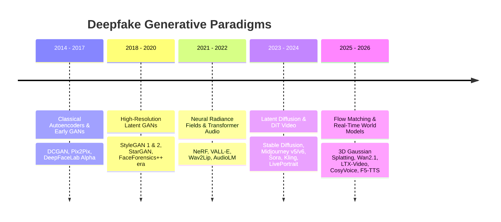
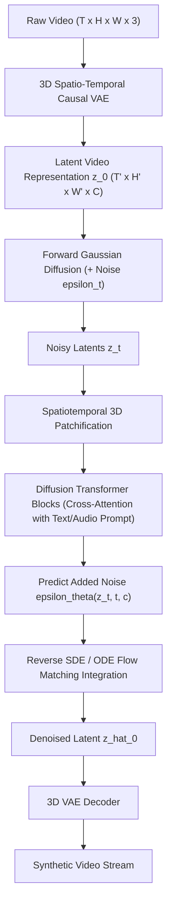
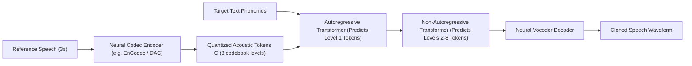
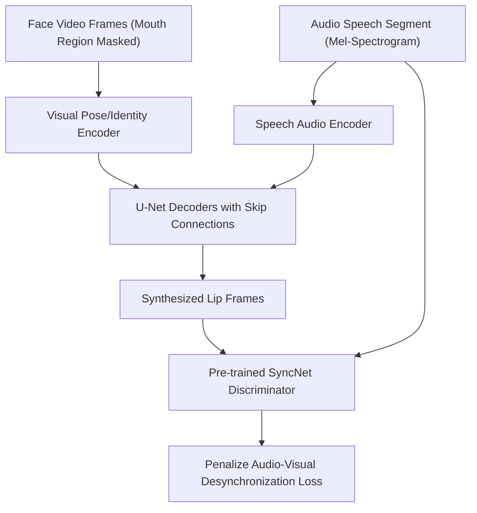

# Deepfake Generation & Synthesis Technologies

<div align="center">

**A comprehensive treatise on algorithmic architectures, loss functions, generative pipelines, and synthesis mechanics across visual, acoustic, multimodal, and 3D domains.**

</div>

---

## 1. Technological Evolution of Generative Synthesis

The mechanisms used to synthesize synthetic human likenesses have evolved through five distinct mathematical paradigms over the last decade:



---

## 2. Visual Deepfake Generation Architectures

Visual deepfake synthesis broadly splits into three operational categories:
1. **Identity Replacement (Face Swapping)**
2. **Expression & Motion Transfer (Facial Reenactment)**
3. **End-to-End Latent Video Synthesis (Text/Image-to-Video)**

### 2.1 Identity Replacement: Autoencoder Disentanglement (DeepFaceLab / FaceSwap)

The foundational architecture pioneered by DeepFaceLab (DFL) uses a shared encoder $E$ with two separate decoders $D_A$ (source identity) and $D_B$ (target identity):

```mermaid
graph LR
    subgraph Training Phase
        IA["Face Image A (Source)"] --> E["Shared Encoder E(x)"]
        IB["Face Image B (Target)"] --> E
        E -->|"Latent z_A"| DA["Decoder D_A"] --> RecA["Reconstructed Face A"]
        E -->|"Latent z_B"| DB["Decoder D_B"] --> RecB["Reconstructed Face B"]
    end
    subgraph Inference Phase (Swap)
        IB2["Target Face B"] --> E
        E -->|"Latent z_B"| DA
        DA --> Swapped["Face with A Identity + B Expression"]
    end
```

#### Loss Functions & Blending Mechanics
Training optimizes a compound objective comprising Pixel Reconstruction ($\mathcal{L}_{\text{pix}}$), Structural Similarity ($\mathcal{L}_{\text{DSSIM}}$), and Perceptual Loss ($\mathcal{L}_{\text{LPIPS}}$):

$$\mathcal{L}_{\text{DFL}} = \alpha \|I - \hat{I}\|_1 + \beta \left(1 - \text{SSIM}(I, \hat{I})\right) + \gamma \sum_l \frac{1}{H_l W_l} \|\phi_l(I) - \phi_l(\hat{I})\|_2^2$$

Where $\phi_l$ represents feature maps from the $l$-th layer of a pre-trained VGG-19 network.

During the **merging stage**, Poisson image blending or seamless cloning is executed along a computed convex hull mask $M$:

$$\min_I \iint_\Omega \|\nabla I - \mathbf{v}\|^2 dx\,dy \quad \text{s.t.} \quad I|_{\partial\Omega} = I^*|_{\partial\Omega}$$

> **Forensic Vulnerability:** Poisson blending forces gradient matching at mask perimeter $\partial\Omega$, leaving subtle chromatic edge discontinuities and boundary artifacts that are detectable via Face X-Ray and spatial edge filtering.

---

### 2.2 Facial Reenactment & Talking Heads (LivePortrait, SadTalker, Thin-Plate Spline)

Rather than replacing facial identity, reenactment transfers the motion vectors (head pose, gaze direction, eye blinks, mouth articulation) of a driver actor onto a source portrait.

#### LivePortrait Mechanics (2024–2026)
LivePortrait operates on implicit keypoints using a landmark-free transformer:
1. **Appearance Feature Extraction**: 3D appearance volume $f_s \in \mathbb{R}^{C \times D \times H \times W}$ extracted via ConvNeXt backbone.
2. **Motion Descriptor Disentanglement**:
   - Head Pose $R \in \text{SO}(3)$, translation $\mathbf{t} \in \mathbb{R}^3$.
   - Facial Expression Code $\delta \in \mathbb{R}^{d_e}$.
   - Source Identity Geometry $x_s \in \mathbb{R}^{K \times 3}$.
3. **Deformation Field Calculation**: Using Thin-Plate Spline (TPS) or dense flow warp:
   $$w(p) = p + \sum_{k=1}^K w_k U(\|p - x_k\|)$$
4. **SPADE Decoding**: Modulating warped features with source identity to synthesize high-fidelity photorealistic frames without landmark jitter.

---

### 2.3 Latent Diffusion & Diffusion Transformers (DiT) for Video

Modern video generation models (OpenAI Sora, Kling 1.5, Wan2.1, LTX-Video) replace U-Nets with **Diffusion Transformers (DiT)** operating over 3D spacetime latent patches.



#### Flow Matching Objective
State-of-the-art 2025/2026 models replace standard DDPM objectives with **Continuous Normalizing Flows (Flow Matching)**:

$$\mathcal{L}_{\text{FM}}(\theta) = \mathbb{E}_{t \sim \mathcal{U}[0,1],\, x_0 \sim p_0,\, x_1 \sim p_1} \left\| v_\theta(x_t, t) - (x_1 - x_0) \right\|^2$$

Where $x_t = (1 - t)x_0 + t x_1$ defines a straight interpolation trajectory between Gaussian noise $x_0$ and real data distribution $x_1$.

> **Forensic Vulnerability:** Flow matching trajectories leave distinctive high-frequency residual traces in the Fourier phase domain and exhibit characteristic reconstruction error trajectories (analyzable via DIRE and CoDE algorithms).

---

## 3. Audio Deepfake & Voice Cloning Technologies

Speech deepfakes have evolved from rudimentary concatenative synthesis into zero-shot autoregressive neural codecs and diffusion acoustic models capable of cloning any human voice from just 3 seconds of reference audio.

### 3.1 Neural Audio Codec + Autoregressive Language Modeling (VALL-E, Voicebox)

VALL-E frames zero-shot TTS as a conditional audio codec language modeling problem:



#### Mathematical Formulation
Given acoustic prompt tokens $\mathbf{C}_{<t}$ and phoneme sequence $\mathbf{x}$, the probability of acoustic token sequence $\mathbf{y}$ is factorized into an autoregressive stage for the first codebook level ($k=1$):

$$p(\mathbf{y}_{\cdot, 1} \mid \mathbf{x}, \mathbf{C}_{\cdot, 1}) = \prod_{t=1}^T p(y_{t, 1} \mid \mathbf{y}_{<t, 1}, \mathbf{x}, \mathbf{C}_{\cdot, 1})$$

Followed by non-autoregressive iterative refinement for residual quantizer levels $k \in [2, 8]$:

$$p(\mathbf{y}_{\cdot, k} \mid \mathbf{x}, \mathbf{y}_{\cdot, <k}) = \prod_{t=1}^T p(y_{t, k} \mid \mathbf{y}_{\cdot, <k}, \mathbf{x})$$

---

### 3.2 Retrieval-Based Voice Conversion (RVC)

RVC is currently the most widely deployed open-source tool for voice conversion in cybercrime and entertainment:
1. **Source Speech Feature Extraction**: Content features extracted using HuBERT or WavLM (stripping speaker identity, retaining linguistic content).
2. **Pitch Extraction**: PM (Praat), Harvest, Crepe, or RMVPE algorithms extract fundamental frequency $F_0$ contour.
3. **Retrieval-Based Timbre Replacement**: K-Nearest Neighbors (KNN) search over a FAISS index of target speaker embeddings to retrieve authentic target voice timbre.
4. **HiFi-GAN Vocoder Synthesis**: Reconstructing waveform conditioning on modified $F_0$ and retrieved acoustic vectors.

> **Forensic Vulnerability:** RVC introduces micro-pitch step artifacts during rapid vocal transitions and exhibits spectral discontinuities in the upper formant regions (>5 kHz).

---

## 4. Lip-Synchronization & Multimodal Synthesis

Multimodal deepfakes synchronize visual mouth movements with an arbitrary speech audio track.

### 4.1 Wav2Lip Pipeline

Wav2Lip uses a pre-trained expert lip-sync discriminator (SyncNet) that remains fixed during generator training to prevent the generator from collapsing into blurry mouth approximations.

$$\mathcal{L}_{\text{sync}} = \frac{\mathbf{v} \cdot \mathbf{a}}{\max(\|\mathbf{v}\|_2 \|\mathbf{a}\|_2, \epsilon)}$$

Where $\mathbf{v}$ is the video embedding of 5 consecutive face frames and $\mathbf{a}$ is the audio embedding of the corresponding speech segment.

$$\mathcal{L}_{\text{total}} = (1 - s_{\text{sync}})\mathcal{L}_{\text{recon}} + s_{\text{sync}}\mathcal{L}_{\text{sync}} + \lambda_{\text{adv}}\mathcal{L}_{\text{adv}}$$



---

## 5. 3D Neural Rendering & Gaussian Splatting Avatars

Recent advances replace 2D pixel warping with 3D explicit representations.

### 5.1 3D Gaussian Splatting (3DGS) Avatars
- A dynamic human head is represented as an explicit set of millions of 3D Gaussian ellipsoids:
  $$G(x) = \exp\left(-\frac{1}{2}(x - \mu)^T \Sigma^{-1} (x - \mu)\right)$$
- Where $\Sigma = R S S^T R^T$ represents covariance parameterized by scaling matrix $S$ and rotation quaternion $R$.
- Expression-dependent deformation fields deform Gaussians according to FLAME or Blendshape parameters.

> **Forensic Vulnerability:** 3DGS deepfakes suffer from "splat popping" across high-velocity head rotations and depth-order sorting artifacts around thin structures such as eyelashes, hair strands, and earlobes.

---

## 6. Synthesis Summary Comparison Table

| Architecture | Modality | GPU Compute Required | Latency (Inference) | Real-Time Feasibility | Chief Forensic Weakness |
|:---|:---|:---|:---|:---:|:---|
| **DeepFaceLab (SAEHD)** | Video (Swap) | High (RTX 3090/4090) | ~3–10 FPS | ❌ (Post-processing required) | Blending boundaries, profile angle failure |
| **SimSwap / InsightFace** | Image/Video (Swap) | Moderate (1x GPU) | ~25–40 FPS | ✅ (Live injection capable) | Identity leakage, lower resolution |
| **LivePortrait** | Video (Reenact) | Low-Moderate | ~30–60 FPS | ✅ (Real-time webcam) | Eye gaze detachment, ear geometry |
| **OpenAI Sora / Kling** | Video (World) | Extreme (Datacenter) | ~0.05 FPS | ❌ (Batch rendering) | Physical causality, limb morphing |
| **VALL-E / ElevenLabs** | Audio (TTS) | Low (Cloud/Edge) | ~100–200ms | ✅ (Interactive telephone) | Micro-prosody rigidity, breathing |
| **RVC (v2)** | Audio (VC) | Very Low (Consumer GPU) | <50ms | ✅ (Live voice changer) | Pitch glitching, formant smearing |
| **Wav2Lip** | Video (Lip-Sync) | Low | ~25 FPS | ✅ (Video calls) | Teeth blurring, temporal smoothing |
| **3DGS Avatars** | Video (3D) | High (Render) | ~60 FPS | ✅ (VR/Metaverse) | Splat popping, silhouette floaters |
