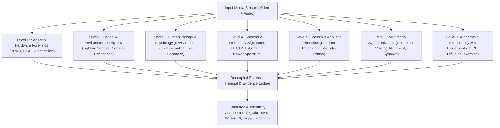
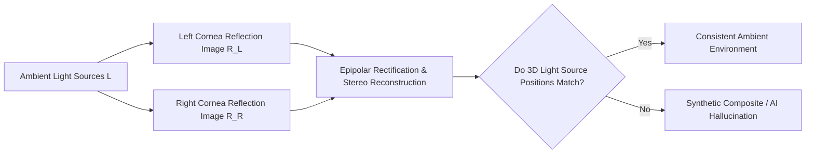
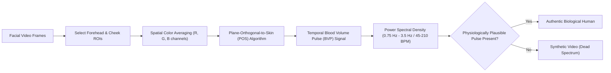
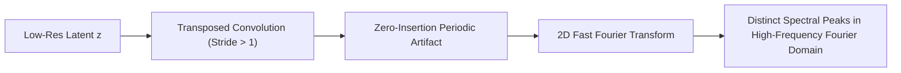

# Multi-Layer Forensic Science & Deepfake Detection

**A comprehensive scientific treatise on forensic methodologies: biological signals, physical laws, sensor physics, spectral signatures, acoustic phonetics, and multimodal harmony.**

---

## 1. The Forensic Philosophy: Beyond Black-Box Classifiers

Standard deep learning detectors (e.g. naive ResNet or EfficientNet classifiers) trained solely on binary labels fail catastrophically when encountering new generative models, unseen compression rates, or post-processing filters.

**Forensic science** differs from standard pattern recognition:
- It grounds authenticity judgments in **immutable physical, biological, or sensor-level invariants**.
- A genuine recording of a human being must satisfy:
  1. **Biological coherence**: Blood circulation causes skin color variations (rPPG); corneas reflect the ambient environment as convex spherical mirrors; eyes blink with asymmetric kinematic acceleration.
  2. **Physical coherence**: Light sources create consistent shadow gradients and 3D surface normal illuminations conforming to Lambertian optics.
  3. **Sensor coherence**: Cameras leave hardware-specific Photo-Response Non-Uniformity (PRNU) patterns and Color Filter Array (CFA) demosaicing traces across every pixel.
  4. **Acoustic coherence**: Human vocal tracts produce continuous phase transitions and acoustic reverberation consistent with the room volume.

---

## 2. Level 1: Sensor & Hardware Forensics

Every digital camera sensor possesses microscopic physical imperfections created during silicon semiconductor fabrication.

### 2.1 Photo-Response Non-Uniformity (PRNU)
The PRNU is an intrinsic, deterministic fingerprint $\mathbf{K}$ unique to each sensor:

$$I = I^{(0)} + I^{(0)} \mathbf{K} + \mathbf{\Theta}$$

Where:
- $I$ is the observed pixel intensity matrix.
- $I^{(0)}$ is the ideal incident light intensity.
- $\mathbf{K}$ is the multiplicative sensor PRNU pattern.
- $\mathbf{\Theta}$ represents additive random noise (shot noise, read noise).

#### Extraction & Detection Protocol
1. Noise residual extraction using a wavelet denoising filter $F$:
   $$W = I - F(I)$$
2. Cross-correlation between the query image noise $W$ and the reference sensor fingerprint $\mathbf{K}$ (or between local facial blocks vs background blocks):
   $$\rho = \frac{(W - \bar{W}) \cdot (\mathbf{K} - \bar{\mathbf{K}})}{\|W - \bar{W}\|_2 \|\mathbf{K} - \bar{\mathbf{K}}\|_2}$$

> **Forensic Reality in Deepfakes:** In a face swap or reenactment, the background retains the genuine sensor PRNU $\mathbf{K}_{\text{bg}}$, while the synthetic facial region contains either zero PRNU or an alien PRNU pattern from a different source, creating an abrupt discontinuity in $\rho$ along the facial perimeter.

---

### 2.2 Color Filter Array (CFA) & Bayer Demosaicing
Digital sensors use a Bayer CFA pattern ($RGGB$). Interpolating missing color channels via demosaicing induces periodic spatial correlations in the second-order derivatives:

$$\Delta_h I(x, y) = I(x+1, y) - 2I(x, y) + I(x-1, y)$$

In synthetic images generated by GANs or Diffusion models, pixel values are synthesized directly without Bayer filtering. The spatial expectation of the demosaicing periodicity is completely absent:

$$\Gamma(\omega_x, \omega_y) = \mathcal{F}\left\{ \mathbb{E}\left[ \Delta_h I(x, y) \cdot \Delta_h I(x+k, y+m) \right] \right\} \equiv 0$$

---

## 3. Level 2: Optical & Environmental Physics

### 3.1 Corneal Specular Reflection Consistency
The human cornea behaves as an optical convex mirror with a standard radius of curvature ($R \approx 7.8\text{ mm}$). For an authentic face illuminated by ambient light sources:

Using corneal reflection analysis:
1. Segment the iris and corneal limbus boundary.
2. Fit an ellipse to extract the corneal normal vector $\mathbf{n}_c$.
3. Compute the reflection vector:
   $$\mathbf{r} = 2(\mathbf{l} \cdot \mathbf{n}_c)\mathbf{n}_c - \mathbf{l}$$
4. Correlate the reconstructed light maps between the left and right eyes.

> **Deepfake Failure Mode:** Generative models synthesize the left and right eyes independently through local attention windows, frequently generating completely different ambient light reflections (e.g. an umbrella light in the left eye and an open window in the right eye).

---

### 3.2 3D Lighting & Lambertian Reflectance Consistency
Under a distant point light source with direction $\mathbf{S} \in \mathbb{R}^3$ and ambient intensity $I_a$, a Lambertian facial surface with albedo $\rho$ and surface normal $\mathbf{N}(x, y)$ satisfies:

$$I(x, y) = \rho(x, y) \left( \mathbf{S} \cdot \mathbf{N}(x, y) + I_a \right)$$

By estimating the 3D facial mesh (e.g. via 3D Morphable Models / 3DMM) and calculating surface normals $\mathbf{N}$, one can solve for the illuminant vector $\mathbf{S}$ using Spherical Harmonics ($Y_{l,m}$):

$$I(x, y) \approx \sum_{l=0}^2 \sum_{m=-l}^l l_{l,m} Y_{l,m}(\mathbf{N}(x, y))$$

If the estimated lighting vector on the swapped face contradicts the cast shadows on the neck or shoulders, the media is demonstrably manipulated.

---

## 4. Level 3: Human Biology & Physiology

### 4.1 Remote Photoplethysmography (rPPG)
Cardiac contractions pump oxygenated blood through the facial vascular network. Hemoglobin absorption of green light ($\sim 530\text{ nm}$) causes periodic, microscopic skin chrominance fluctuations invisible to the naked human eye but extractable via video processing.

#### The Plane-Orthogonal-to-Skin (POS) Formulation
The temporal chrominance signals are projected onto a plane orthogonal to the skin tone:

$$S = P \cdot C_n$$

Where $C_n(t)$ is the normalized RGB channel vector, and the temporal blood volume pulse is derived as:

$$\text{BVP}(t) = S_1(t) + \frac{\sigma(S_1)}{\sigma(S_2)} S_2(t)$$

Real humans exhibit a sharp fundamental cardiac frequency ($0.75\text{--}2.5\text{ Hz}$) with high spatio-temporal coherence across facial regions. Deepfakes exhibit either flatline power spectra or uncorrelated noise across distinct facial segments.

---

### 4.2 Spontaneous Eye-Blink Kinematics
Human spontaneous blinking exhibits an **asymmetric kinematic profile**:
- Closing phase (down-phase): Extremely rapid ($75\text{--}100\text{ ms}$), driven by the orbicularis oculi muscle.
- Opening phase (up-phase): Slower ($150\text{--}300\text{ ms}$), driven by the levator palpebrae superioris.

$$v_{\text{closing}} \approx 2.5 \times v_{\text{opening}}$$

Generative reenactment models (e.g. Wav2Lip, early DeepFaceLab) either fail to blink over long durations or generate symmetric sinusoidal eye closure curves that violate human neuromuscular biology.

---

## 5. Level 4: Spectral & Frequency Signatures

### 5.1 The Up-Sampling Spectral Grid Artifact
Generative neural networks upscale low-resolution latent vectors to high-resolution images using transposed convolutions (`ConvTranspose2d`) or nearest-neighbor / bilinear interpolation followed by standard convolutions.

#### Mathematical Proof of Grid Replicas
Upscaling by a factor $M$ with zero-insertion produces periodic replication of the spectrum:

$$X_{\text{up}}(\omega) = X(M\omega)$$

The convolution kernel $h[n]$ cannot perfectly filter out the spectral replicas at frequencies $\omega = \frac{2\pi k}{M}$, resulting in pronounced high-frequency spectral spikes detectable via **Azimuthal Average Integration**:

$$A(r) = \frac{1}{2\pi} \int_0^{2\pi} |\mathcal{F}(I)(r, \theta)| d\theta$$

Real camera images exhibit a smooth, monotonically decaying power law ($A(r) \propto r^{-\alpha}, \alpha \approx 2$). Generative models display severe ripples and sharp spikes at periodic harmonic radial distances $r$.

---

## 6. Level 5: Acoustic & Audio Forensics

### 6.1 Formant Trajectory & Vocal Tract Geometry
Human speech is produced by airflow from the lungs passing through the vocal cords (excitation source) and being shaped by the vocal tract cavities (pharynx, oral cavity, nasal cavity). This creates resonance peaks called **formants** ($F_1, F_2, F_3$):

$$F_n = \frac{(2n - 1)c}{4L}, \quad n \in \{1, 2, 3\}$$

Where $c$ is the speed of sound and $L$ is the physical vocal tract length ($\sim 17\text{ cm}$ in adult males, $\sim 14.5\text{ cm}$ in adult females).

In synthetic speech generated by neural TTS or voice conversion:
- The virtual vocal tract length $L(t)$ calculated by solving the inverse acoustic problem fluctuates erratically frame-by-frame, implying physically impossible morphing of the speaker's skull and throat bones during a single sentence.

### 6.2 Phase Discontinuity & Biphonation
- Authentic speech possesses smooth instantaneous phase transitions:
  $$\phi(t) = \arg\left(s(t) + j\mathcal{H}\{s(t)\}\right)$$
- Neural vocoders (HiFi-GAN, WaveGlow) synthesize speech frame-by-frame in short-time Fourier domains, leaving micro-phase jumps at $10\text{--}20\text{ ms}$ frame boundaries.

---

## 7. Level 6: Multimodal Harmony & Audio-Visual Forensics

### 7.1 Phoneme-Viseme Cross-Modal Synchronization
Human speech mechanics dictate that acoustic bursts corresponding to specific phonemes must align with precise oral shapes (visemes):

| Phoneme Class | IPA Symbols | Anatomical Realization (Viseme) | Audio-Visual Timing Expectation |
|:---|:---|:---|:---|
| **Bilabial Plosives** | /p/, /b/, /m/ | Complete lip closure followed by burst | Audio burst occurs precisely at lip separation ($\Delta t \le 20\text{ ms}$) |
| **Labiodental Fricatives**| /f/, /v/ | Lower lip contacts upper incisors | Continuous friction noise during sustained tooth-lip contact |
| **Alveolar Plosives** | /t/, /d/, /n/ | Tongue touches alveolar ridge | Mouth open, tongue occlusion visible |
| **Open Vowels** | /ɑ/, /æ/ | Wide vertical jaw drop, retracted tongue | Maximum acoustic energy envelope correlates with oral opening aperture |

In multimodal deepfakes (e.g. Wav2Lip or audio dubbing), audio bursts for /p/ or /b/ frequently occur while the mouth is completely open, or bilabial lip closure occurs without any acoustic silence, creating a measurable cross-modal dissonance:

$$d_{\text{AV}}(t) = \| \mathbf{f}_{\text{visual}}(t) - \mathcal{W}(\mathbf{f}_{\text{audio}}(t)) \|_2$$

---

## 8. Level 7: Algorithmic Model Attribution

Forensics can determine not only *that* a video is fake, but *which exact architecture* created it.

### 8.1 Diffusion Reconstruction Error (DIRE)
Diffusion models (e.g. Stable Diffusion, Midjourney) preserve an inherent inductive bias: an image generated by a diffusion model can be inverted into latent space and reconstructed with significantly lower error than an authentic camera photograph.

$$\text{DIRE}(x) = |x - \hat{x}|, \quad \hat{x} = \text{Decoder}(\text{DDIM\_Forward}(\text{DDIM\_Reverse}(x)))$$

$$\begin{cases}
\|\text{DIRE}(x)\|_1 \ll \tau & \implies \text{Synthesized by Diffusion Model} \\
\|\text{DIRE}(x)\|_1 \ge \tau & \implies \text{Real Photograph or GAN Synthesis}
\end{cases}$$

---

## 9. Forensic Evidence Matrix

| Forensic Domain | Invariant Tested | Attack Robustness (Social Compression) | Automation Feasibility | Real-Time Capable |
|:---|:---|:---:|:---:|:---:|
| **PRNU Noise Fingerprint** | Silicon sensor fabrication irregularities | Low (Lost at JPEG Q < 70) | Fully automated | ❌ (Compute-heavy) |
| **CFA Demosaicing** | Bayer filter interpolation grid | Very Low | Fully automated | ✅ |
| **Corneal Reflection** | Convex mirror environmental physics | Moderate | Semi-automated | ❌ (Manual eye zoom) |
| **3D Lambertian Lighting** | Global light vector consistency | High | Fully automated | ❌ |
| **rPPG Cardiac Pulse** | Biological blood absorption dynamics | Moderate (Needs uncompressed video) | Fully automated | ✅ (~30 FPS) |
| **Blink Kinematics** | Neuromuscular velocity asymmetry | High (Survives compression) | Fully automated | ✅ |
| **Azimuthal FFT Spectrum** | Up-sampling grid replication | High (Present even at low resolution)| Fully automated | ✅ |
| **Phoneme-Viseme Sync** | Anatomical speech articulation | Very High | Fully automated | ✅ |
| **DIRE Latent Error** | Generative diffusion inversion error | Moderate | Fully automated | ❌ (Multiple diffusion steps) |
