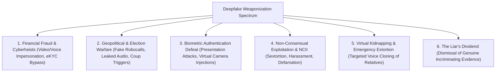
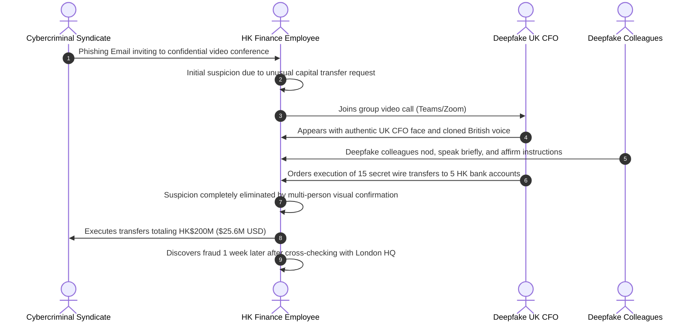
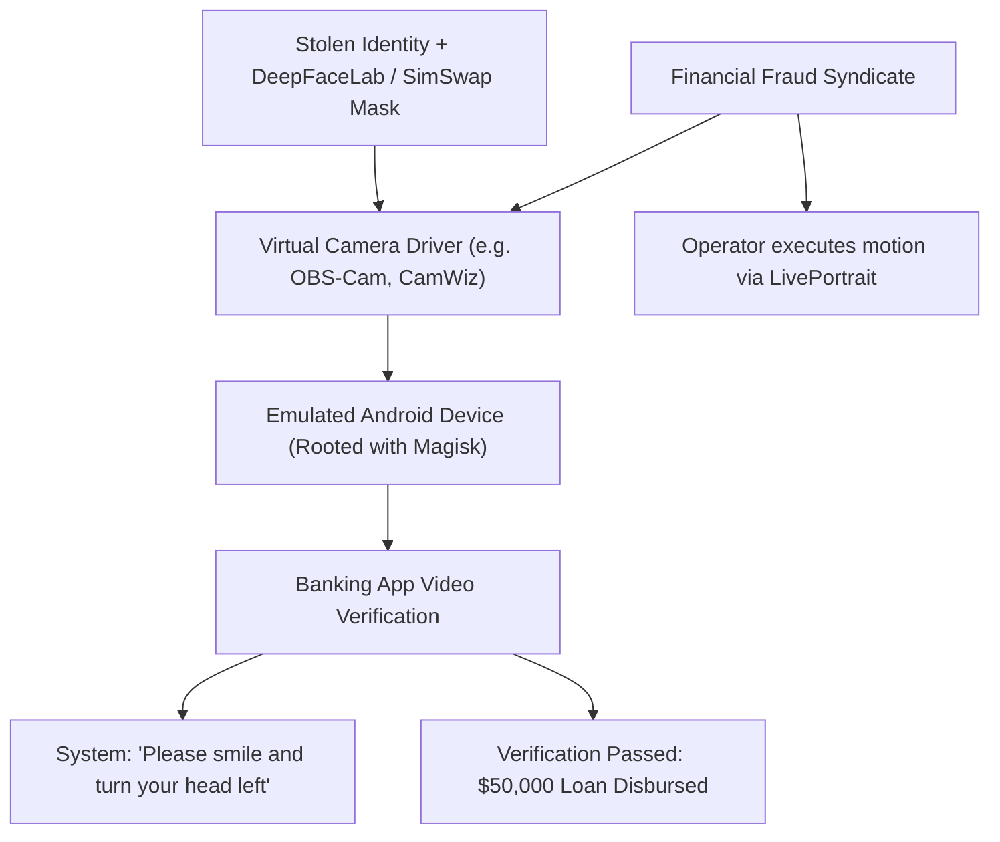
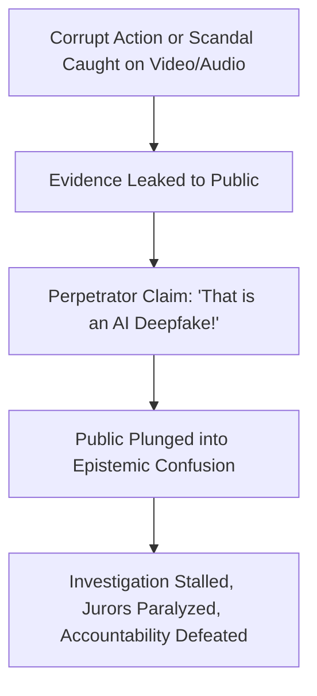

# Deepfake Threat Matrix & Real-World Incident Case Studies

**An investigative research dossier on weaponized synthetic media: financial cyberheists, election sabotage, national security crises, biometric identity theft, non-consensual exploitation, and the Liar's Dividend.**

---

## 1. Threat Taxonomy & Attack Matrix

Deepfakes have transitioned from experimental laboratory curiosities to active attack vectors utilized by transnational criminal syndicates, nation-state intelligence agencies, commercial fraudsters, and domestic harassers.

### 1.1 Threat Severity & Impact Matrix

| Threat Category | Primary Target | Technical Vector | Average Financial/Societal Impact | Detectability at Point of Attack |
|:---|:---|:---|:---|:---:|
| **Executive Impersonation (BEC)** | Multinational Enterprises, Treasury Teams | Real-time video conferencing deepfakes + voice cloning | $250K – $30M+ per incident | Extremely Low (Real-time pressure) |
| **Biometric eKYC Injection** | Fintech, Digital Banks, Crypto Exchanges | Virtual camera stream loopback with face-swapped IDs | Multi-million account takeover / loan fraud | Moderate (Liveness bypass tools) |
| **Democratic Election Sabotage** | Voting Populations, Media Outlets | Synthetic audio leaks timed <48 hours before voting | Unquantifiable (Electoral illegitimacy) | High (Post-hoc), Zero (Pre-vote) |
| **NCII & Sextortion** | Women, Minors, Public Figures | Open-source face swap bots (Telegram, web services) | Severe psychological trauma, extortion | High (Visual inspection often sufficient) |
| **Virtual Kidnapping Scams** | Elderly Citizens, Parents | 3-second voice clone of crying child/relative via phone | $5,000 – $50,000 per victim | Zero (Emotional shock disables logic) |
| **The Liar's Dividend** | Corrupt Politicians, Criminal Defendants | Legal/public rhetoric dismissing genuine video evidence | Total epistemic erosion of visual truth | N/A (Exploits public skepticism) |

---

## 2. Exhaustive Real-World Incident Case Studies

---

### Case Study 1: The $25.6 Million Hong Kong Multinational CFO Heist (Arup Case, 2024)
- **Date:** January–February 2024
- **Target:** Hong Kong regional office of British engineering multinational firm **Arup**.
- **Loss:** HK$200 million (~US$25.6 million) across 15 transactions.
- **Weaponization Pipeline:** Real-time multi-person video conference deepfake.

#### Forensic & Operational Breakdown:
1. **How it Succeeded:** The attackers reconstructed not just a single executive, but an **entire multi-person conference call** using publicly available YouTube footage, conference presentations, and corporate earnings call recordings of London-based executives.
2. **Technical Architecture:** Pre-rendered video clips fed through a virtual camera driver (such as OBS Virtual Cam) with responsive voice-conversion audio triggered by human operators reading scripted corporate jargon.
3. **Defense Failure:** Zero out-of-band cryptographic authentication was required for multi-million-dollar wire authorizations.

---

### Case Study 2: The New Hampshire Presidential Primary Joe Biden Robocall (2024)
- **Date:** January 21, 2024 (two days prior to the NH Democratic Primary)
- **Target:** Estimated 25,000 New Hampshire registered Democratic voters.
- **Payload:** Cloned voice of US President Joe Biden advising citizens **not to vote** in the primary.
- **Text Transcript:** *"Save your vote for the November election... voting this Tuesday only enables the Republicans in their quest to elect Donald Trump again."*

#### Legal & Regulatory Repercussions:
1. **Federal Indictment:** Steve Kramer indicted on 13 felony counts of voter suppression and 13 misdemeanor counts of impersonation of a candidate.
2. **FCC Enforcement:** The FCC issued a historic **$6 Million fine** against Kramer and a **$2 Million fine** against Lingo Telecom for transmitting illegal deepfake robocalls.
3. **Policy Pivot:** Catalyzed the FCC's formal Declaratory Ruling on February 8, 2024, officially classifying AI-generated synthetic voices as "artificial" under the Telephone Consumer Protection Act (TCPA), making unsolicited AI voice calls illegal nationwide.

---

### Case Study 3: The Slovakian Parliamentary Election Eve Deepfake (September 2023)
- **Date:** September 28–29, 2023 (48-hour electoral moratorium before national voting)
- **Target:** Michal Šimečka (Leader of the pro-Western Progressive Slovakia party) and Monika Tódová (Investigative Journalist for Denník N).
- **Format:** High-fidelity synthetic audio recording.
- **Narrative:** The fabricated audio depicted Šimečka discussing how to rig the election by buying votes from the minority Roma population and bribing electoral officials.

#### Strategic Timing & Attack Dynamics:
- **The 48-Hour Blackout Window:** Slovak law imposes a strict 48-hour pre-election media moratorium where political parties and media cannot air campaign debates or campaign-related news.
- **Asymmetric Advantage:** The deepfake circulated virally on Telegram and Facebook, amassing hundreds of thousands of views. Because of the blackout, traditional news organizations were legally restricted from broadcasting fact-checks or forensic rebuttals.
- **Outcome:** Progressive Slovakia lost the election by a razor-thin margin to the populist Smer party led by Robert Fico. This incident is globally cited as the first documented instance where an audio deepfake plausibly impacted a national parliamentary election outcome.

---

### Case Study 4: The Gabon President Ali Bongo Stroke Reenactment & Military Coup (2018–2019)
- **Date:** December 31, 2018 – January 7, 2019
- **Context:** President Ali Bongo of Gabon suffered a stroke in October 2018 and disappeared from public view for months.
- **Incident:** The Gabonese government released a televised New Year’s address video showing Bongo speaking stiffly from a desk in Morocco to prove he was healthy and in control.
- **Reaction:** Dissident groups, military factions, and international forensic amateurs analyzed the video, highlighting that Bongo’s eyes barely blinked, his mouth movements seemed decoupled, and his right arm was immobile. They concluded the video was an AI deepfake created by his political faction to conceal his death or incapacitation.
- **Consequence:** On January 7, 2019, Gabonese military officers launched an armed coup d'état, explicitly citing the "deepfake" New Year's video as proof the presidency was vacant.
- **The Liar's Dividend Paradox:** Medical experts later confirmed the video was likely authentic: Bongo's facial stiffness and lack of blinking were classic physical sequelae of his stroke. The mere *suspicion* of a deepfake triggered a military uprising.

---

### Case Study 5: The UK Energy Firm CEO Voice Clone Heist ($243,000, 2019)
- **Target:** British subsidiary of a prominent German energy conglomerate.
- **Method:** Cloned audio of the German CEO demanding an urgent €220,000 transfer to a Hungarian supplier within one hour.
- **Technical Nuance:** The attacker replicated the subtle German accent, vocal timbre, and cadence of the chief executive, complete with conversational acoustic background noise.
- **Detection Point:** A second transfer was requested; the UK executive called the real CEO directly via a verified private line, discovering the German CEO had never called.

---

### Case Study 6: Biometric Banking eKYC Injection Attacks
Modern digital banks and fintech platforms verify new customers remotely via electronic Know-Your-Customer (eKYC) apps:

- In 2023–2024, cybercrime rings in China, Southeast Asia, and Europe were dismantled after using virtual camera injection to open over 100,000 fraudulent bank accounts, evading commercial 3D liveness detection by re-routing synthetic video streams directly into the operating system's video capture subsystem (`/dev/video0`).

---

### Case Study 7: Non-Consensual Intimate Imagery (NCII) & Mass Exploitation
- **Scope:** Over 96% of all deepfake videos online are non-consensual pornography, targeting almost exclusively women (99%+).
- **Key Incidents:**
  1. **Taylor Swift (January 2024):** Synthetic explicit images generated via jailbroken diffusion prompts received over 47 million impressions on X (formerly Twitter) within 17 hours before takedown, prompting White House press briefings and bipartisan Congressional action.
  2. **Spanish Almendralejo Schoolgirls Scandal (2023):** Over 20 underage girls had their social media photos scraped by male classmates and processed through automated Telegram deepfake stripping bots, sparking nationwide protests and legal overhauls across Spain.
  3. **Twitch Streamer Atrioc Incident (2023):** Revealed widespread commercial websites dedicated to synthesizing deepfake adult content of popular female livestreamers from everyday streaming video feeds.

---

## 3. The "Liar's Dividend": Weaponizing Skepticism

First articulated by legal scholars **Professors Robert Chesney and Danielle Citron** (2018), the **Liar's Dividend** describes a sinister epistemic side effect:

$$\text{As public awareness of deepfakes increases, bad actors can dismiss authentic incriminating evidence as AI-generated fabrications.}$$

### Notable Manifestations:
1. **Donald Trump (Access Hollywood tape reconsidered):** Beginning in late 2017, reports indicated Trump privately questioned the authenticity of the 2005 *Access Hollywood* tape, suggesting his voice may have been fabricated.
2. **Elon Musk / Tesla Autopilot Lawsuit (2023):** Tesla attorneys argued in court that Musk's 2016 public recorded statements claiming *"a Model S and Model X can drive autonomously with greater safety than a person"* could not be admitted into evidence without rigorous verification, arguing Musk is a frequent target of deepfake voice clones. The presiding judge rejected the argument, calling it *"deeply troubling"*.
3. **Indian Politics (2024):** State politicians caught on tape accepting bribes routinely issue public press releases claiming the audio files are *"AI-generated deepfakes created by opposition political conspirators."*

---

## 4. Threat Surface Evolution Matrix (2024–2028 Horizon)

| Attack Vector | Current State (2026) | Projected Horizon (2028) | Recommended Countermeasure |
|:---|:---|:---|:---|
| **Real-time Video Calls** | Minor motion artifacts, rigid eyes | Indistinguishable photorealism, dynamic 3D rendering | Out-of-band mutual challenge phrases; C2PA video streams |
| **Voice Cloning** | Requires 1-3 seconds of audio | Zero-shot real-time stream interception with dynamic acoustic floor | Hardware cryptoprocessors on enterprise telephony lines |
| **eKYC Biometrics** | Virtual camera loopbacks deceive basic apps | Biometric deepfakes simulating blood pulse (rPPG) | Anti-hooking hardware secure enclaves (TEE, Apple Secure Enclave) |
| **Legal Evidence Admissibility** | Judges rely on expert witness testimony | Complete admissibility breakdown without cryptographic provenance | Mandatory cryptographic C2PA timestamping on police bodycams |
