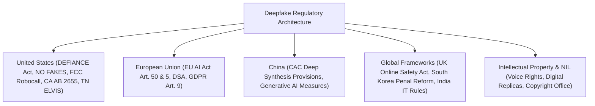
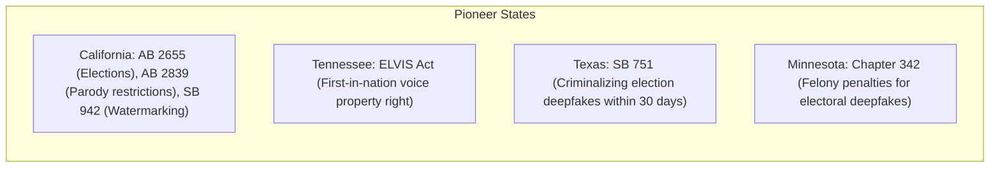
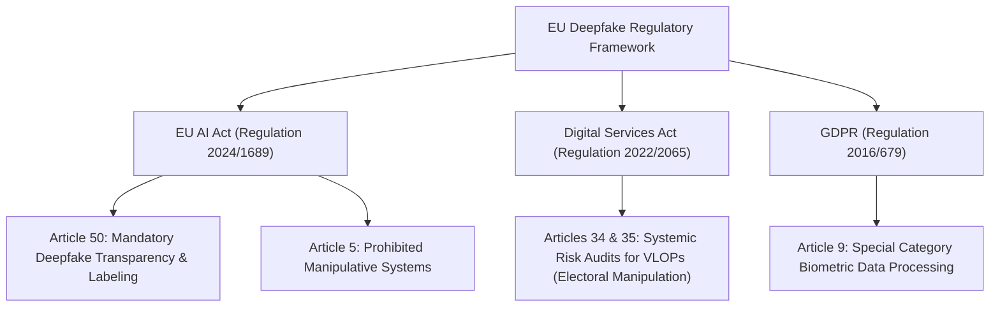
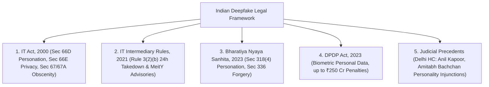
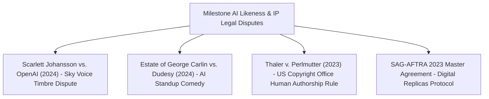

# Deepfake Legal, Regulatory & Policy Compendium

**A comprehensive analysis of international, federal, and state statutory frameworks, criminal and civil liabilities, intellectual property rights, and AI governance mandates.**

---

## 1. Global Legal Landscape Overview

The rapid weaponization of generative media has triggered an unprecedented legislative response across international jurisdictions. Legal frameworks have evolved from attempting to stretch legacy statutes (e.g. wire fraud, standard defamation, classical copyright) to enacting **specialized, domain-specific deepfake legislation**.

---

## 2. United States Federal & State Legislation

---

### 2.1 Federal Legislation & Administrative Rulings

#### A. The DEFIANCE Act of 2024 (S. 3696)
- **Official Title:** *Disrupt Explicit Forged Images and Non-Consensual Edits Act of 2024*
- **Sponsors:** Sen. Dick Durbin (D-IL), Sen. Lindsey Graham (R-SC), Sen. Josh Hawley (R-MO), Sen. Amy Klobuchar (D-MN).
- **Legislative Status:** Unanimously passed the United States Senate on July 23, 2024.
- **Core Statutory Remedy:**
  - Creates a **federal civil cause of action** for victims of non-consensual sexually explicit deepfakes.
  - Grants victims the right to sue anyone who knowingly produced, possessed with intent to distribute, or distributed the material without consent.
  - Statutory Damages: Up to **$150,000 per violation** plus punitive damages and attorney's fees, regardless of whether actual financial damages can be proven.

#### B. The NO FAKES Act of 2024
- **Official Title:** *Nurture Originals, Foster Art, and Keep Entertainment Safe Act of 2024*
- **Sponsors:** Sen. Chris Coons (D-DE), Sen. Marsha Blackburn (R-TN), Sen. Amy Klobuchar (D-MN), Sen. Thom Tillis (R-NC).
- **Core Provision:**
  - Establishes a **federal intellectual property right** in every individual’s voice and visual likeness.
  - Protects performers and ordinary citizens against unauthorized "digital replicas".
  - Duration: Protects an individual throughout their lifetime and extends for **70 years posthumously** to heirs and estates.
  - Imposes statutory damages of up to $5,000 per unauthorized digital replica creation or distribution.

#### C. FCC Declaratory Ruling on AI Robocalls (February 8, 2024)
- **Statutory Authority:** Telephone Consumer Protection Act (TCPA), 47 U.S.C. § 227.
- **Holding:** The Federal Communications Commission (FCC) unanimously declared that **AI-generated voices constitute "artificial or prerecorded voices"** under the TCPA.
- **Legal Effect:** Makes the use of cloned voices in automated telemarketing or political robocalls illegal without prior express written consent, empowering State Attorneys General and the FCC to levy fines up to $23,000 per unauthorized call.

#### D. FTC Trade Regulation Rule on Impersonation (16 CFR Part 461)
- Promulgated April 2024 by the Federal Trade Commission.
- Explicitly makes it a federal violation to use synthetic media to impersonate businesses or government officials to extract money, consumer credentials, or sensitive data.
- Authorizes the FTC to directly file federal court actions to recover redress for defrauded consumers and obtain civil penalties.

---

### 2.2 United States State-Level Statutes

#### California
1. **AB 2655 (Defending Democracy from Deepfake Election Deception Act of 2024):**
   - Mandates large online platforms remove or label deceptive audio/video of candidates or election officials within 120 days before an election and 60 days after.
2. **SB 942 (California AI Transparency Act of 2024):**
   - Requires covered generative AI providers to offer a free, publicly accessible AI-detection tool and embed imperceptible, tamper-evident cryptographic provenance data (C2PA-compliant) in synthetic media.

#### Tennessee — The ELVIS Act (2024)
- **Official Name:** *Ensuring Likeness Voice and Image Security Act* (Signed March 21, 2024).
- **Historical Significance:** Updated Tennessee’s historic Protection of Personal Rights law to explicitly add **"Voice"** alongside name, photograph, and likeness as a protected property right.
- Enacted directly to protect Nashville musicians and songwriters from voice-cloning piracy.

---

## 3. European Union Regulatory Architecture

The European Union governs deepfakes through a multi-tiered legislative matrix anchored by the **EU Artificial Intelligence Act (Regulation (EU) 2024/1689)**, the **Digital Services Act (DSA)**, and the **General Data Protection Regulation (GDPR)**.

### 3.1 The EU AI Act (Regulation 2024/1689)

#### Article 50: Transparency Obligations for Certain AI Systems
- **Mandatory Disclosure:** Providers and deployers of AI systems that generate or manipulate image, audio, or video content that appreciably resembles existing persons, objects, or events (deepfakes) must **clearly and visibly disclose that the content has been artificially generated or manipulated**.
- **Exceptions:** Narrow exemptions exist for authorized criminal investigations and legitimate artistic, satirical, or creative works, provided the parody disclosure is prominent.
- **Machine-Readable Provenance:** Technical providers must ensure synthetic outputs are marked in a machine-readable format and detectable via open standards.

#### Article 5: Prohibited AI Practices
- AI systems that deploy **subliminal, manipulative, or deceptive techniques** with the objective or effect of materially distorting human behavior in a manner that causes significant psychological or physical harm are strictly banned within the EU.

#### Fines & Non-Compliance Penalties
- Violations of transparency mandates carry administrative fines up to **€15 million or 3% of total worldwide annual turnover**.
- Violations of prohibited practices carry fines up to **€35 million or 7% of total worldwide annual turnover**.

---

### 3.2 The Digital Services Act (DSA)
- Classifies platforms with >45 million EU monthly active users as **Very Large Online Platforms (VLOPs)**.
- Articles 34 and 35 compel VLOPs to conduct annual systemic risk assessments regarding the spread of deceptive synthetic media affecting democratic elections, public security, and gender-based violence.

---

## 4. China: Cyberspace Administration of China (CAC)

China was the first global jurisdiction to implement binding, comprehensive administrative regulations governing synthetic media.

### 4.1 Deep Synthesis Provisions (Effective January 10, 2023)
- **Title:** *Provisions on the Administration of Deep Synthesis Internet Information Services*
- **Key Mandates:**
  1. **Real-Name Verification:** Users of deep synthesis tools must undergo real-name identity registration using national ID numbers or phone numbers.
  2. **Indelible Watermarking:** Service providers must apply both **explicit visible watermarks** and **implicit cryptographic digital watermarks** that cannot be stripped during file conversion or compression.
  3. **Consent Requirement:** Prior explicit informed consent must be obtained from any individual before their biometric traits (face, voice) can be synthesized.
  4. **Security Assessment Filing:** Algorithms must be formally registered and audited in the CAC National Algorithmic Registry (*互联网信息服务算法备案系统*).

---

---

## 5. India: Comprehensive Statutory, Regulatory & Judicial Framework

India possesses a multi-layered legal regime governing deepfakes, spanning the **Information Technology Act, 2000**, the **IT Intermediary Rules, 2021 (with MeitY Advisories)**, the newly codified **Bharatiya Nyaya Sanhita (BNS), 2023**, and landmark **High Court Personality Rights Jurisprudence**.

### 5.1 The Information Technology Act, 2000
- **Section 66D (Cheating by Personation Using Computer Resource):**
  - Criminalizes using any computer resource, communication device, or generative AI pipeline to cheat by impersonating another individual.
  - **Penalty:** Imprisonment for a term up to **3 years** and a fine up to **₹1,00,000**.
- **Section 66E (Violation of Bodily Privacy):**
  - Punishes the intentional capturing, publishing, or transmitting of images of private areas of any person without consent.
  - **Penalty:** Imprisonment up to **3 years** or a fine up to **₹2,00,000**, or both.
- **Sections 67 & 67A (Obscene & Sexually Explicit Acts in Electronic Form):**
  - Applied directly to non-consensual deepfake pornography (NCII). First conviction carries up to **5 years imprisonment** and ₹10 Lakhs fine; subsequent convictions carry up to **7 years imprisonment**.

---

### 5.2 IT (Intermediary Guidelines) Rules, 2021 & MeitY Statutory Advisories

#### The 24-Hour Mandatory Takedown Mandate (Rule 3(2)(b))
- Online intermediaries (Meta, YouTube, X, Telegram) must, within **24 hours** from the receipt of a complaint, remove or disable access to any material that exposes private areas of an individual, shows the individual in full/partial nudity, or **depicts the individual in any sexual act or conduct, or where the individual is impersonated in an electronic form**.

#### Section 79 "Safe Harbor" Immunity Stripping
- Under Section 79(1) of the IT Act, platforms enjoy legal immunity from user-generated content.
- However, if an intermediary fails to observe due diligence under Rule 3 or fails to take down flagged deepfakes within statutory timelines after receiving government or court notice, **Safe Harbor immunity is forfeited**, making platform executives directly liable for prosecution under Indian criminal law.

#### MeitY Deepfake Advisories (2023–2024)
- **November 7, 2023 Advisory:** Issued immediately after the Rashmika Mandanna incident, mandating platforms clearly communicate prohibited content categories (specifically synthetic impersonation) to users during sign-up and through periodic terms updates.
- **December 26, 2023 Advisory:** Directed platforms to deploy automated technical algorithms to proactively detect and prevent the dissemination of deepfakes and misinformation.
- **March 1 & March 15, 2024 Advisories:** Mandated explicit visual labeling of AI-generated content, unique metadata tagging for provenance, and strict compliance during general elections.

---

### 5.3 Bharatiya Nyaya Sanhita (BNS), 2023 (In effect from July 1, 2024)

The BNS replaced the colonial Indian Penal Code (IPC) of 1860, codifying specialized provisions applicable to synthetic media:

| Offense | BNS Section | Corresponding Old IPC Section | Legal Application to Deepfakes | Maximum Sentence |
|:---|:---:|:---:|:---|:---:|
| **Cheating by Personation** | **Section 318(4)** | Section 419 | Creating synthetic audio/video impersonating executives, officials, or relatives | Up to 5 years imprisonment + Fine |
| **Forgery for Harming Reputation** | **Section 336** | Section 469 | Fabricating political or celebrity deepfakes intending to harm character or standing | Up to 3 years imprisonment + Fine |
| **Criminal Defamation** | **Section 356** | Section 499 / 500 | Disseminating deepfakes alleging false criminal acts or corruption | Up to 2 years imprisonment / Community service |
| **Insulting Modesty of a Woman** | **Section 79** | Section 509 | Synthesizing non-consensual deepfakes, morphs, or unnudified images of women | Up to 3 years imprisonment + Fine |
| **Promoting Enmity between Groups**| **Section 196** | Section 153A | Fabricating deepfake communal speeches or altered religious statements | Up to 3 to 5 years imprisonment |

---

### 5.4 Digital Personal Data Protection Act, 2023 (DPDP Act)
- Defines biometric data as personal data.
- Generative AI models trained by scraping photographs of Indian citizens without express, unconditional consent violate data processing mandates.
- The Data Protection Board of India (DPBI) is empowered to impose civil penalties up to **₹250 Crores (US$30 Million)** for systemic data fiduciary non-compliance.

---

### 5.5 Landmark Judicial Precedents: Personality & Publicity Rights

The Delhi High Court has established trailblazing international jurisprudence protecting Indian celebrities and citizens against generative AI misappropriation:

#### A. Anil Kapoor v. Simply Life India & Ors (CS(COMM) 652/2023)
- **Ruling Date:** September 20, 2023 (Justice Prathiba M. Singh).
- **Core Holding:** The Delhi High Court granted an unprecedented **omnibus ex-parte interim injunction** restraining defendants, artificial intelligence tool operators, and the public from using actor Anil Kapoor's:
  - Name, photograph, likeness, and image.
  - Distinctive voice and acoustic timbre.
  - Iconic catchphrase (*"jhakaas"*).
  - Any digital avatar, deepfake, or generative face-swap for commercial or derogatory purposes without his prior license.
- **Judicial Significance:** Specifically prohibited generative AI face-swapping apps and voice changers from incorporating his biometric likeness into their models.

#### B. Amitabh Bachchan v. Rajat Nagi & Ors (CS(COMM) 819/2022)
- First landmark Indian ruling protecting an individual's right of publicity and personality rights against unauthorized voice-cloning, phone ringtones, and synthetic merchandise.

#### C. Jackie Shroff v. The Peppy Store & Ors (2024)
- Affirmed that celebrity sobriquets (*"Bhidu"*), distinctive vocal drawls, and personal mannerisms cannot be cloned or weaponized in synthetic media.

---

## 6. Global Statutory Comparisons

| Jurisdiction | Primary Legislation | Focus / Target | Enforcement Mechanism | Top Penalty |
|:---|:---|:---|:---|:---|
| **India** | IT Act (Sec 66D/66E), IT Rules (24h takedown), BNS 2023, DPDP Act | Impersonation, NCII, Electoral disinformation, Biometric privacy | MeitY, Cyber Police (IFSO), Data Protection Board | Up to 7 years prison / ₹250 Cr civil penalty / Loss of Safe Harbor |
| **United States** | DEFIANCE Act, FCC TCPA, CA AB 2655, TN ELVIS | NCII, Robocalls, Elections, Voice IP | Civil federal lawsuits, FCC fines, State AGs | $150K statutory damages / $6M FCC fine |
| **European Union** | EU AI Act (Art. 50 & 5), DSA, GDPR | Transparency, Systemic Platform Risk | European AI Office, National Regulators | €35M or 7% global annual turnover |
| **China** | CAC Deep Synthesis Provisions | Social Stability, Algorithmic Control | Cyberspace Administration of China (CAC) | Service shutdown, administrative detention |
| **United Kingdom**| Online Safety Act 2023 | NCII, Minor Protection | Ofcom, Crown Prosecution Service | Imprisonment up to 2 years for creators |
| **South Korea** | Sexual Violence Punishment Act | NCII & Deepfake Pornography | National Police Agency Cyber Bureau | 5 to 7 years imprisonment |

---

## 6. Intellectual Property, Likeness Rights & Case Law Precedents

### 6.1 Scarlett Johansson vs. OpenAI (May 2024)
- **Incident:** OpenAI released a ChatGPT voice persona named "Sky" whose cadence and timbre bore an uncanny resemblance to Scarlett Johansson's performance in the film *Her*.
- **Legal Precedent:** Invoked the landmark common law right-of-publicity precedent **Midler v. Ford Motor Co. (9th Cir. 1988)**:
  $$\text{"When a distinctive voice of a professional singer is widely known and is deliberately imitated in order to sell a product, the sellers have appropriated what is not theirs."}$$
- **Outcome:** OpenAI paused the Sky voice without formal litigation, demonstrating the commercial liability of voice imitation.

### 6.2 Estate of George Carlin vs. Dudesy (April 2024)
- **Incident:** Podcast comedy channel Dudesy synthesized a 1-hour comedy special titled *"George Carlin: I'm Glad I'm Dead"* using an AI model trained on decades of Carlin's copyrighted comedy albums.
- **Outcome:** Carlin's estate filed suit in federal court for copyright infringement and right-of-publicity violation; defendants settled, agreeing to permanently delete the video and destroy all underlying AI models.

### 6.3 US Copyright Office: Human Authorship Requirement
In *Zarya of the Dawn* (2023) and *Thaler v. Perlmutter* (D.D.C. 2023), the United States Copyright Office and federal courts affirmed:
- **Core Doctrine:** Copyright law protects only the fruits of **human intellectual labor**.
- AI-synthesized imagery or audio without substantial human creative control is dedicated immediately to the public domain and cannot be copyrighted.
