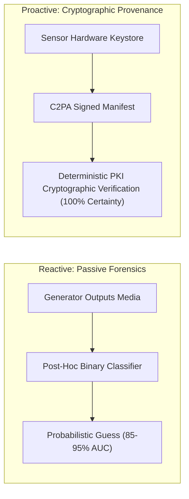
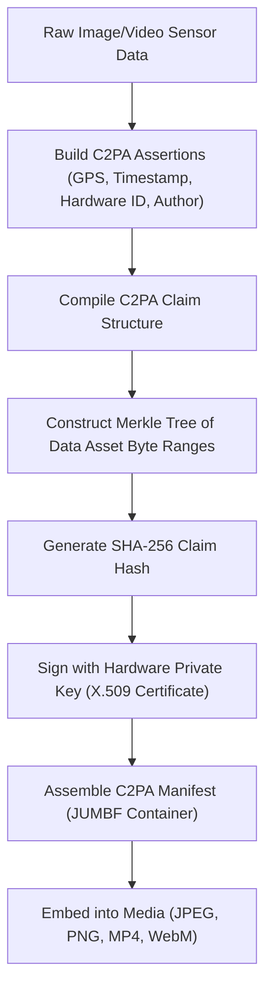
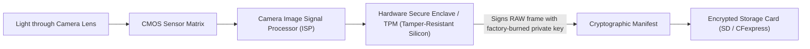
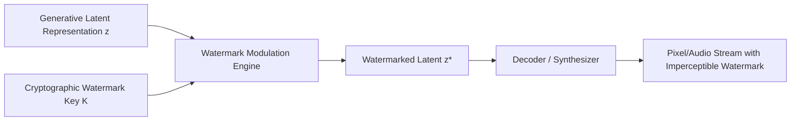
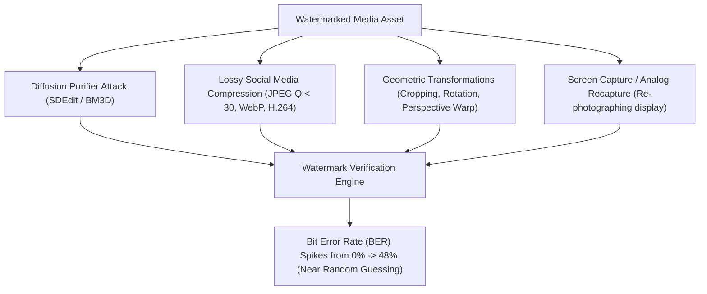
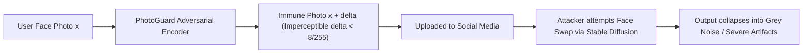

# Cryptographic Provenance, C2PA & Watermarking Standards

**A technical treatise on the transition from reactive forensic detection to active cryptographic authenticity: C2PA specifications, hardware roots of trust, neural watermarking, and adversarial cloaking.**

---

## 1. The Paradigmatic Shift: Detection vs. Provenance

In information security, **passive forensic detection** is fundamentally an asymmetric cat-and-mouse game:
- Generative AI improves continuously; detection models experience distributional shift with every new foundation architecture.
- In contrast, **active cryptographic provenance** establishes an immutable chain of custody from photon capture at the hardware sensor to final rendering on the user's display.

---

## 2. The C2PA Standard Architecture (Coalition for Content Provenance and Authenticity)

The C2PA specification (developed jointly by Adobe, Microsoft, Intel, Arm, Truepic, Sony, and Leica) is the internationally adopted open technical standard for content authenticity.

### 2.1 C2PA Core Components

1. **Assertions**: Individual discrete facts about the asset:
   - `c2pa.actions`: Edit history (e.g., cropped, color-graded, AI-inpainted).
   - `c2pa.hash.data`: Precise byte hashes of the image or audio stream.
   - `c2pa.camera`: Sensor metadata, lens serial numbers, exposure time.
2. **Claim**: A cryptographically formatted JSON structure linking all assertions and identifying the exact hashing algorithms:
   $$\text{Claim} = \left\{ \text{assertions}: [A_1, A_2, \dots, A_n], \;\text{alg}: \text{"sha256"}, \;\text{format}: \text{"image/jpeg"} \right\}$$
3. **Claim Signature**: The digital signature computed over the Claim using an authorized private key matching an X.509 digital certificate rooted in a public certificate authority (CA):
   $$\Sigma = \text{Sign}_{K_{\text{priv}}}(\mathcal{H}(\text{Claim}))$$
4. **Manifest Store**: Encapsulated within the **JPEG Universal Metadata Box Format (JUMBF)** (`ISO/IEC 19566-5`) embedded inside the binary file structure without degrading legacy viewer compatibility.

---

### 2.2 Hardware Roots of Trust in Digital Cameras

To prevent software spoofing before signature creation, cryptographic signing must occur **directly inside the camera hardware**:

#### Production Implementations:
1. **Leica M11-P (First Production C2PA Camera):** Features an integrated Infineon Secure Element chip containing a factory-burned unique private key, producing tamper-evident DNG raw files with verifiable hardware provenance.
2. **Sony Alpha Series (A7 IV, A9 III, A1 Firmware Updates):** Embedded in-camera digital signatures certifying image capture authenticity for photojournalists.
3. **Canon EOS R5 Mark II:** Hardware-bound digital authenticity system tailored for news agencies.

---

## 3. Neural Digital Watermarking

When media must be distributed on platforms that strip metadata, **in-band digital watermarks** embedded directly into the pixel/latent representations provide resilience.

### 3.1 Google DeepMind SynthID
SynthID embeds digital watermarks across multiple modalities without impacting visual or acoustic quality:
- **SynthID-Image:** Operates in the frequency latent space of Imagen/Diffusion models. It modulates the distribution of latent features across specific frequency bands using an adversarial objective ensuring imperceptibility ($\text{PSNR} > 42\text{ dB}$).
- **SynthID-Text:** Modulates the probability logits of token generation in large language models (LLMs).
- **SynthID-Audio:** Inserts watermarks into the spectrogram domain of Lyria music/speech generation.

### 3.2 Meta Stable Signature
Stable Signature fine-tunes the latent decoder of a latent diffusion model (LDM) to inherently produce watermarked images:
- Given an arbitrary message $m \in \{0, 1\}^k$:
  $$\min_{\theta_{\text{dec}}} \mathbb{E}_{z \sim p(z),\, \epsilon} \left[ \mathcal{L}_{\text{perceptual}}(x, \hat{x}) + \lambda \mathcal{L}_{\text{BCE}}(D(D_{\theta_{\text{dec}}}(z)), m) \right]$$
- Every image generated by the modified decoder automatically carries the bit-string $m$.

### 3.3 Tree-Ring Watermarking
Tree-Ring watermarking embeds an indelible Fourier-space watermark into the initial Gaussian noise vector $z_T \sim \mathcal{N}(0, \mathbf{I})$ of a diffusion model:

$$z_T(u, v) = \begin{cases} r_k \cdot e^{j \theta_k} & \text{if } \sqrt{u^2 + v^2} \in [R_{\min}, R_{\max}] \\ \mathcal{N}(0, 1) & \text{otherwise} \end{cases}$$

The inverted latent vector (obtained via DDIM inversion) retains the ring-like geometric pattern, allowing detection via circular harmonic correlation.

---

## 4. Adversarial Attacks Against Watermarks

Digital watermarking is vulnerable to several active adversarial removal attacks:

### The Diffusion Purifier Attack
An adversary can strip latent watermarks by passing the image through a forward-reverse diffusion cycle:
1. Add small Gaussian noise to watermarked image $x^*$:
   $$x_t = \sqrt{\bar{\alpha}_t} x^* + \sqrt{1 - \bar{\alpha}_t} \epsilon, \quad t \approx 0.15 T$$
2. Run reverse diffusion using a standard, unwatermarked foundation model:
   $$\hat{x} = \text{Denoise}(x_t, t)$$
3. **Outcome:** High-frequency watermark bits are destroyed while the semantic image content remains virtually identical.

---

## 5. Defensive Cloaking & Facial Poisoning

Rather than detecting deepfakes after creation, **defensive cloaking** immunizes personal photographs *before* they are uploaded to the internet, preventing malicious actors from using them as training data or face-swap targets.

### 5.1 MIT PhotoGuard
PhotoGuard applies imperceptible adversarial perturbations $\delta$ to a portrait photo $x$:

$$\min_\delta \|\delta\|_\infty \quad \text{s.t.} \quad \|\delta\|_\infty \le \epsilon, \quad \mathcal{L}_{\text{target}}(\text{DiffusionInpaint}(x + \delta, M), x_{\text{gray}}) \le \tau$$

#### Two Operating Modes:
1. **Encoder Attack:** Optimizes $\delta$ to disrupt the latent encoder $E(x + \delta)$, causing the diffusion model to perceive the input as pure Gaussian noise.
2. **Diffusion Attack:** Optimizes $\delta$ to force the reverse diffusion trajectory toward an arbitrary target (e.g. an empty grey canvas).

### 5.2 Glaze & Nightshade (University of Chicago)
- **Glaze:** Applies style cloaking perturbations to prevent generative models from learning an artist’s visual style.
- **Nightshade:** An offensive-defensive poisoning tool that subtly alters image features so that concept association models misclassify data (e.g. teaching a diffusion model that images of "handbags" are "toasters", destabilizing model training at scale).

---

## 6. Provenance & Authenticity Matrix

| Standard / System | Technology Type | Security Level | Resistance to Screenshot | Resistance to Diffusion Purifier | Deployment Status |
|:---|:---|:---:|:---:|:---:|:---|
| **C2PA Standard** | Cryptographic Manifest / PKI | SAL-4 (Hardware) / SAL-3 | ❌ (Strips container) | N/A (External container) | Active (Adobe, Leica, Sony, Canon) |
| **SynthID** | Latent Neural Watermark | SAL-2 | Moderate | Moderate | Active (Google Imagen / Gemini) |
| **Stable Signature** | Decoder-embedded Watermark | SAL-2 | Moderate | Weak-Moderate | Open Source / Meta Research |
| **Tree-Ring Watermark** | Initial Noise Fourier Key | SAL-2 | Weak | Weak | Academic Standard |
| **PhotoGuard** | Adversarial Perturbation Cloak | SAL-3 (Preventative) | Moderate | Moderate | Open Source / MIT |
| **Glaze / Nightshade** | Feature Space Poisoning | SAL-3 (Preventative) | High | High | Active Public Download |
