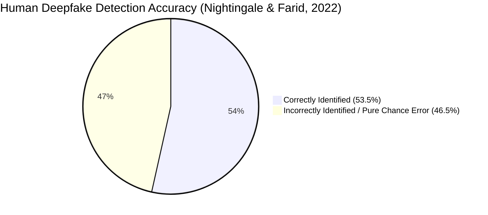
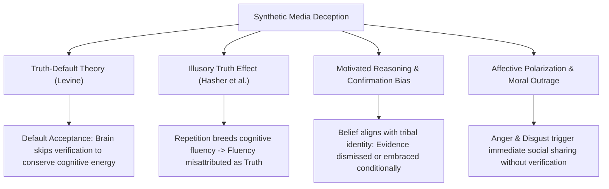
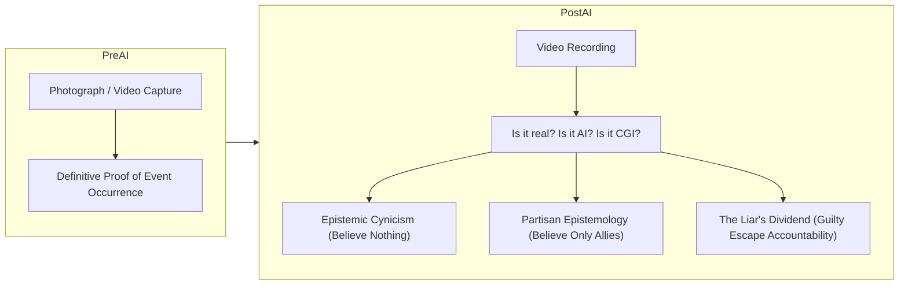

# Psychology, Perception & Societal Impact of Deepfakes

<div align="center">

**A comprehensive behavioral and epistemic study: human perceptual failure, the AI hyperrealism effect, Truth-Default Theory, the epistemic crisis of visual evidence, and psychological inoculation.**

</div>

---

## 1. The Perceptual Illusion: Why Humans Cannot Detect Deepfakes

For over 150 years, photography and video served as the primary **indexical records of physical reality**: if an event was captured on film, society accepted as an axiomatic premise that the event physically occurred. Deepfakes shatter this foundational epistemic contract.

Numerous large-scale empirical psychological trials demonstrate that **unaided human perception is wholly inadequate for detecting modern synthetic media**:



### 1.1 Key Empirical Findings

1. **Nightingale & Farid (PNAS 2022):**
   - Evaluated human observers across hundreds of photorealistic synthetic faces synthesized via StyleGAN2 vs real photographs.
   - **Result:** Overall human detection accuracy was **53.5%** — statistically indistinguishable from a random coin flip ($p > 0.05$).
2. **Miller et al. (Psychological Science 2023) — The AI Hyperrealism Effect:**
   - Evaluated subjective evaluations of authenticity and trustworthiness.
   - **Result:** Participants rated AI-generated synthetic faces as **more real** than actual photographs of genuine humans.
   - **Root Cause:** Generative models are trained on curated internet datasets biased toward symmetrical, blemish-free, prototypical facial proportions. The human brain perceives average, symmetrical faces as more familiar, attractive, and inherently trustworthy.

---

## 2. Cognitive Biases Exploited by Deepfakes

Deepfakes do not operate in an objective vacuum; they weaponize human evolutionary psychology and heuristics:



### 2.1 Truth-Default Theory (TDT)
Formulated by Professor Timothy Levine, **Truth-Default Theory** posits that during interpersonal communication, humans default to the presumption that the other party is communicating honestly.
- Constantly questioning the veracity of every visual and acoustic stimulus would cause cognitive paralysis.
- As a consequence, viewers rarely inspect videos for subtle temporal artifacts or voice cadence glitches unless a prior, high-salience suspicion trigger is actively presented.

### 2.2 The Illusory Truth Effect & Cognitive Fluency
- When an individual is exposed to a claim or video multiple times across social feeds, the mental processing of that information becomes easier (**cognitive fluency**).
- The human brain systematically misinterprets cognitive ease as a marker of truth.
- Even if a viewer initially suspects a deepfake video is fabricated, repeated algorithmic exposure across TikTok, X, and WhatsApp gradually solidifies the event as true in implicit memory.

### 2.3 The Continued Influence Effect (CIE)
Even after a deepfake is conclusively debunked by trusted forensic experts, the **Continued Influence Effect** ensures that the false narrative continues to influence the individual’s inferences and memory:
$$\text{Memory}(\text{Event}) = \text{Trace}(\text{Fabrication}) + \lambda \cdot \text{Trace}(\text{Correction})$$
Where the correction trace decay rate $\lambda$ is significantly higher than the emotional memory trace of the original fabricated video.

---

## 3. The Epistemic Crisis & The Collapse of Visual Truth



### 3.1 Dimensions of the Epistemic Crisis

1. **Epistemic Nihilism:** When citizens realize that any video or audio can be forged with zero visual telltales, they frequently succumb to nihilistic skepticism: *"Nothing is real, and the truth is unknowable."* This apathy paralyzes democratic participation and civic engagement.
2. **Partisan Epistemology:** In the absence of objective visual standards, truth becomes tribal. Media that denigrates a political opponent is instantly embraced as authentic; media that exposes wrongdoing within one’s own tribe is dismissed as an enemy AI deepfake.
3. **The Erosion of Legal Jurisprudence:** The foundation of criminal prosecution (CCTV footage, police body cameras, wiretapped phone conversations) is increasingly challenged in courtrooms, increasing the burden of proof and lengthening trials.

---

## 4. Societal Defense: Cognitive Inoculation & Prebunking

Post-hoc fact-checking ("debunking") is fundamentally reactive and structurally disadvantaged: it arrives hours or days after a viral deepfake has already reached millions of minds.

The leading psychological countermeasure is **Cognitive Inoculation (Prebunking)**, pioneered by **McGuire (1964)** and modernized for digital disinformation by **van der Linden and Roozenbeek (Cambridge University)**.

```mermaid
sequenceDiagram
    autonumber
    actor System as Prebunking Initiative (Civic / Educational)
    actor Citizen as Online Citizen
    actor Attacker as Disinformation Operative

    System->>Citizen: 1. Forewarning: "Malicious actors will use AI to fake political audio before elections"
    System->>Citizen: 2. Micro-Dosing: Demonstrates sample deepfake with visible manipulation techniques
    System->>Citizen: 3. Cognitive Refutation: Equips with mental antibodies ("Notice missing breath sounds & rigid blinking")
    Attacker->>Citizen: Deploys viral deepfake election audio
    Citizen->>Citizen: Recognizes manipulation pattern immediately; emotional outrage neutralized
    Citizen->>Attacker: Refuses to share; reports media for forensic authentication
```

### 4.1 The SIFT Method for Citizen Media Literacy
Developed by digital literacy scholar **Mike Caulfield**, the SIFT framework provides an actionable cognitive heuristic for citizens encountering sensational digital media:

| Step | Action | Practical Execution |
|:---:|:---|:---|
| **S** | **Stop** | Pause when feeling strong visceral outrage, panic, or vindication. Do not share or react immediately. |
| **I** | **Investigate the Source** | Check who published the clip. Is it a verified news organization with a public corrections policy, or an anonymous account? |
| **F** | **Find Trusted Coverage** | Search whether independent, verified outlets have confirmed the event, or if it exists only in isolated social echo chambers. |
| **T** | **Trace Claims to Context** | Use reverse image search or C2PA manifest inspection to identify the original source footage and chronological capture date. |

---

## 5. Psychological & Epistemic Matrix

| Phenomenon | Psychological Mechanism | Exploitative Deepfake Use | Countermeasure / Defense |
|:---|:---|:---|:---|
| **AI Hyperrealism** | Prototypical symmetry perceived as trustworthy | Creating attractive synthetic avatars for LinkedIn/Tinder scamming | Algorithmic biometric detectors (rPPG, PRNU) |
| **Truth-Default** | Human presumption of honesty | Social engineering calls mimicking family members in distress | Established family "safe words" and out-of-band phone callbacks |
| **Illusory Truth** | Repetition creates cognitive fluency | Algorithmic bot swarms retweeting deepfake clips | Social media platform velocity throttles & C2PA labeling |
| **Confirmation Bias** | Belief validation prioritizes tribal cohesion | Electoral scandal deepfakes released 24h prior to voting | Prebunking campaigns informing voters of expected tactics |
| **Liar's Dividend** | Skepticism weaponized to evade accountability | Corrupt officials dismissing real recordings as deepfakes | Cryptographic camera capture signatures (C2PA) from moment of recording |
