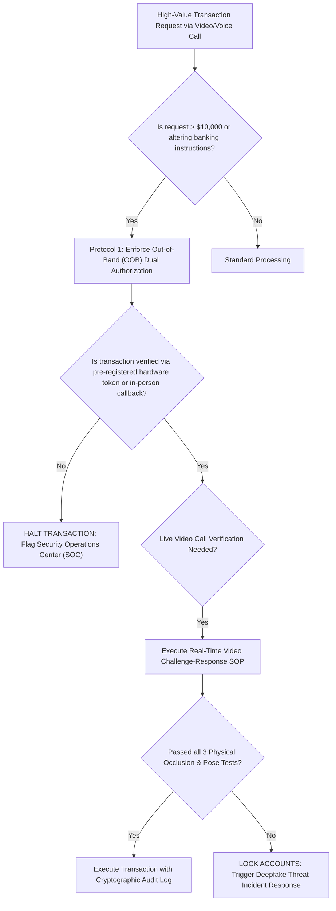
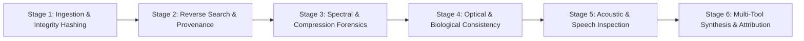
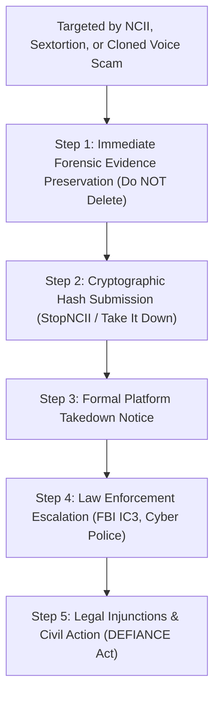
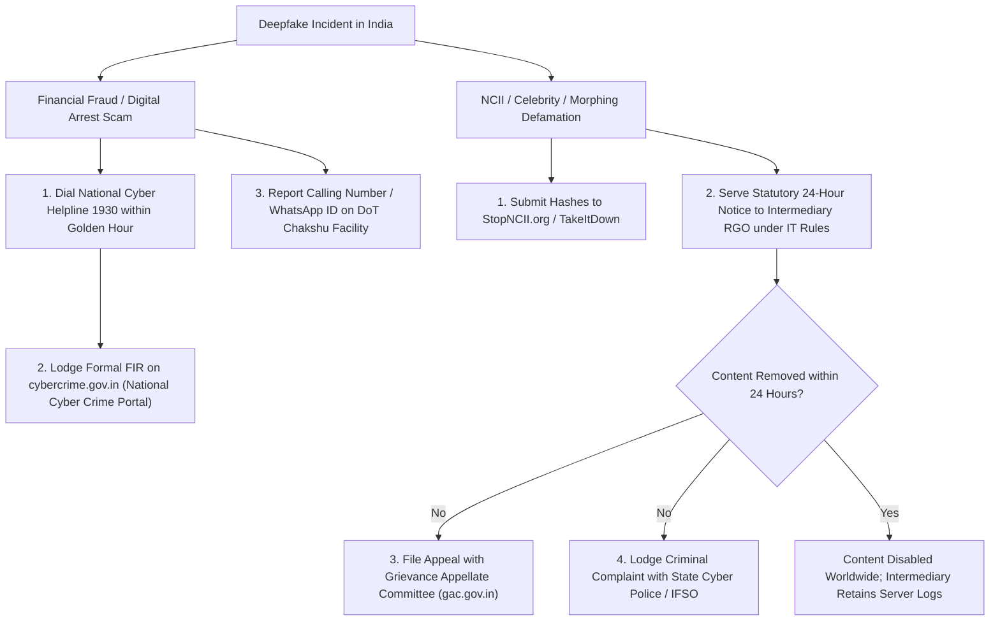

# Deepfake Defense Playbooks & Incident Response Protocols

<div align="center">

**Actionable, standard operating procedures (SOPs) for enterprise security teams, forensic journalists, intelligence analysts, and individual victims.**

</div>

---

## 1. Enterprise & Corporate Security Playbook (Anti-Executive Impersonation)

To prevent catastrophic multi-million-dollar cyberheists (such as the $25.6M Hong Kong video conference fraud), organizations must enforce systematic technical controls and procedural gates.



### 1.1 The Real-Time Video Conference Challenge-Response Protocol

When an executive or supervisor requests urgent financial transfers, password resets, or sensitive IP disclosure on a live video conference (Zoom, Teams, Google Meet), the receiving employee must execute **three mandatory physical challenge tests**:

| Challenge Test | Execution Instruction | Underlying Failure Mode in Deepfakes | Expected Result on Real Human |
|:---|:---|:---|:---|
| **1. The 90-Degree Profile Turn** | *"Please turn your head fully to the left, then fully to the right, looking 90 degrees away from the camera."* | 2D face-swap models (SimSwap, RoOP) and reenactment models (LivePortrait) rely on frontal facial landmarks ($[-45^\circ, +45^\circ]$). At extreme profile angles, landmark tracking collapses, causing the synthetic face to detach, smear, or vanish. | Clean profile showing normal ear anatomy and jawline without latency. |
| **2. Hand Occlusion Sweep** | *"Please hold your open hand directly in front of your nose and mouth, moving your fingers back and forth across your face."* | Generative autoencoders and latent inpainting algorithms do not segment foreground occlusions. Moving a hand across the face causes violent pixel tearing, warping around fingers, and face ghosting on top of the palm. | Hand cleanly covers mouth/nose; fingers remain crisp and correctly ordered in depth. |
| **3. Dynamic Unscripted Dialogue** | *"Can you tell me what color socks you are wearing right now, or solve: what is 17 plus 28?"* | Attackers operating soundboards or voice conversion scripts rely on pre-recorded sound bites or linear prompt scripts. Spontaneous dynamic queries disrupt script flow and expose conversational latency (>1.5s). | Immediate natural acoustic reaction without awkward synthesizer pauses. |

### 1.2 Anti-Injection Defense (Virtual Camera Prevention)
- Attackers inject synthetic video by routing pre-recorded deepfake streams into software virtual camera drivers (e.g., `v4l2loopback`, `OBS-VirtualCam`, `CamTwist`).
- **Enterprise Endpoint Hardening:**
  - Enforce Mobile Device Management (MDM) policies blocking installation of virtual camera drivers and root/jailbreak modules (`Magisk`, `Frida`).
  - Configure enterprise conferencing software (Zoom / Microsoft Teams) to restrict video input devices strictly to certified hardware USB/integrated webcams using hardware peripheral IDs (Vendor ID / Product ID verification).

---

## 2. Journalist & Fact-Checker Forensic Protocol

When breaking audio or video clips surface during elections or breaking news crises, newsrooms and open-source intelligence (OSINT) analysts should follow a **6-stage forensic triage workflow**:



### Stage 1: Ingestion & Evidence Preservation
- **Immediate Hash:** Compute SHA-256 and MD5 hashes of the query media file immediately upon receipt.
- **Header Metadata Extraction:** Run `exiftool -a -u -g1 query_file.mp4` to inspect container creation timestamps, camera serial tags, and check for `c2pa` JUMBF metadata boxes.
- Never inspect media solely on social platforms; always download the original uncompressed container stream.

### Stage 2: Reverse Search & Source Tracing
- Segment video into keyframes using InVID / WeVerify plugin or FFmpeg:
  ```bash
  ffmpeg -i input.mp4 -vf select='gt(scene\,0.4)',scale=1280:-1 -vsync vfr keyframe_%03d.png
  ```
- Run reverse image queries across Google Lens, Yandex, Bing Visual Search, and TinEye on isolated keyframes and face crops to find the original untampered source footage.

### Stage 3: Spectral & Compression Forensics
- **Error Level Analysis (ELA):** Detect inconsistent JPEG/video compression levels across facial regions vs background.
- **Fourier 2D FFT Analysis:** Examine high-frequency power spectrum for upsampling grid spikes or azimuthal power decay abnormalities (indicative of GAN/Diffusion synthesis).

### Stage 4: Optical & Biological Consistency
- **Corneal Reflections:** Zoom into left and right pupil specular highlights. Do ambient window/light shapes match in 3D geometry?
- **Lighting & Shadows:** Estimate 3D nose cast shadows relative to ambient neck illumination.
- **Teeth & Earlobe Details:** Look for morphing teeth boundaries, blurred jewelry, or ears that melt into the neck during motion.

### Stage 5: Acoustic & Speech Forensics
- Load speech track into Audacity or Sonic Visualiser:
  - Check for artificial frequency cutoffs (e.g. sharp cliff at 8 kHz or 16 kHz indicative of telephony or neural vocoders).
  - Inspect pauses between words: is there genuine ambient room tone (HVAC noise, room reverb) or unnatural digital silence ($\text{dB} = -\infty$)?

### Stage 6: Multi-Tool Synthesis & Transparent Reporting
- Run automated benchmarks (DeepShield AI, DeepfakeBench).
- **Reporting Guideline:** Never declare a file "100% authentic" or "100% fake" based on an automated classifier. Provide a calibrated forensic report listing specific physical, biological, and cryptographic facts observed.

---

## 3. Personal Protection & Victim Incident Response

If an individual or minor is targeted by non-consensual deepfake pornography (NCII), extortion, or a virtual kidnapping voice scam:



### Step 1: Evidence Preservation (Chain of Custody)
- **Do not immediately delete the media or block the perpetrator.**
- Record complete screen recordings showing:
  - Full URLs in the browser address bar.
  - Social media account handles, profile IDs, and phone numbers.
  - Time and date stamps.
  - Direct message transcripts and payment demands (crypto addresses, bank details).
- Save source files locally with timestamps and compute SHA-256 hashes for legal admissibility.

### Step 2: Cryptographic Hash Submission (Platform Blocking)
Submit digital fingerprints of the media to international hashing clearinghouses. **Crucially: raw images are NOT uploaded; only mathematical perceptual hashes are shared:**
1. **Adult Victims:** Submit to **[StopNCII.org](https://stopncii.org)** (operated by the Revenge Porn Helpline). Generates perceptual hashes (PDQ and PhotoDNA) distributed to Meta (Instagram, Facebook), TikTok, OnlyFans, Reddit, and Threads to automatically block re-uploads.
2. **Minors (Under 18):** Submit to **[Take It Down](https://takeitdown.ncmec.org)** (operated by the National Center for Missing & Exploited Children - NCMEC).

### Step 3: Formal Platform Takedown Notice Template
Send urgent takedown notices to platform designated DMCA / safety agents referencing governing statutes:

> **Subject:** Urgent Takedown Notice: Non-Consensual Deepfake Exploitation / Impersonation
> 
> To the Trust & Safety Team at [Platform Name]:
> 
> I am writing to provide formal notice of an unlawful, non-consensual synthetic digital replica depicting my likeness [or minor child] located at:
> - URL: `[Insert URL]`
> - Account Handle: `[Insert Username]`
> 
> This content constitutes:
> 1. A non-consensual sexually explicit synthetic replica under the federal DEFIANCE Act of 2024 (S. 3696) and applicable state laws.
> 2. An unlawful misappropriation of voice and likeness rights.
> 3. A material violation of your Platform Terms of Service regarding non-consensual sexual content and synthetic impersonation.
> 
> I demand the immediate removal and worldwide disabling of this content, preservation of all server logs and account creation IP addresses for law enforcement referral, and confirmation of deletion within 24 hours.

### Step 4: Law Enforcement Reporting
- **United States:** File an immediate report with the **FBI Internet Crime Complaint Center (IC3)** at [ic3.gov](https://www.ic3.gov) and contact local law enforcement cybercrime divisions.
- For extortion involving minors, report directly to the **NCMEC CyberTipline** (1-800-843-5678).

### Step 5: Family Voice Scam Protocol (Virtual Kidnapping)
- **The "Family Safe Word":** Establish a private, un-guessable family verbal passphrase with children and elderly parents.
- If receiving an emergency call claiming a loved one has been kidnapped or arrested:
  1. Ask: *"What is our secret family safe word?"*
  2. Hang up immediately.
  3. Call the loved one back directly on their known, verified mobile telephone number.
  4. Never transfer funds or cryptocurrency via untraceable payment channels under telephonic duress.

---

## 4. India-Specific Defense & Incident Response Protocols

For citizens, enterprises, and public figures in India encountering deepfake extortion, NCII, Digital Arrest scams, or election disinformation:



### 4.1 Immediate Response to "Digital Arrest" & Financial Scams
1. **The "Golden Hour" Protocol (Helpline 1930):**
   - If money was transferred under coercion via RTGS/NEFT/IMPS/UPI, dial **1930** immediately.
   - Operated by the Indian Cyber Crime Coordination Centre (I4C, Ministry of Home Affairs). It triggers the **Citizen Financial Cyber Fraud Reporting System (CFCFRS)**, freezing funds in destination bank accounts and crypto exchanges before fraudsters can withdraw them.
2. **National Cyber Crime Portal:**
   - Log on to **[cybercrime.gov.in](https://cybercrime.gov.in)**.
   - Select *"Report Cyber Crime"* (anonymous reporting available for women and children under the *Women/Child Related Crime* category).
3. **DoT Chakshu & Sanchar Saathi Reporting:**
   - For scam calls, spoofed police video requests, or suspicious WhatsApp calls, report via the Department of Telecommunications (DoT) **Chakshu portal** at [sancharsaathi.gov.in/sfc](https://sancharsaathi.gov.in/sfc/).
   - Triggers nationwide blacklisting and IMEI blocking of fraudulent devices across all telecom service providers (Airtel, Jio, Vi, BSNL).

---

### 4.2 Statutory Legal Takedown Notice for Indian Platforms (IT Rules 2021)

Send this formal legal notice to the platform's **Resident Grievance Officer (RGO)** in India:

> **Subject:** Urgent Statutory Takedown Notice under Rule 3(2)(b) of IT Rules, 2021 — Non-Consensual Deepfake / Personation
> 
> To: The Resident Grievance Officer, [Platform Name India]  
> 
> I am writing under **Rule 3(2)(b) of the Information Technology (Intermediary Guidelines and Digital Media Ethics Code) Rules, 2021**, and the **MeitY Advisories of November/December 2023**:
> 
> 1. **Violative Content URL:** `[Insert URL / Post Link / Account Handle]`
> 2. **Description of Violation:** The aforementioned content depicts an artificially manipulated, synthetic digital replica (deepfake) of my person [or victim name], falsely portraying me without consent.
> 3. **Statutory Non-Compliance:** This content directly violates **Rule 3(1)(b)(v) and Rule 3(1)(b)(vii)** of the IT Rules, 2021, and constitutes criminal offenses under **Section 66D and Section 66E of the Information Technology Act, 2000**, and **Section 318(4) and Section 79 of the Bharatiya Nyaya Sanhita, 2023**.
> 
> In accordance with **Rule 3(2)(b)**, you are statutory bound to **remove or disable access to this content within 24 hours** from receipt of this notice. Failure to do so will result in the immediate forfeiture of your intermediary immunity under **Section 79(1) of the IT Act, 2000**, exposing the platform and its officers to joint criminal liability.
> 
> Preserve all access logs, IP addresses, phone numbers, and transmission records for hand-over to law enforcement agencies.

---

### 4.3 Escalation to the Grievance Appellate Committee (GAC)
- If an intermediary fails to respond or refuses to take down the deepfake within statutory deadlines:
- File a digital appeal directly with the Union Government's **Grievance Appellate Committee (GAC)** at **[gac.gov.in](https://gac.gov.in)** within 30 days. The GAC is an executive tribunal empowered to issue binding orders forcing platform compliance.

