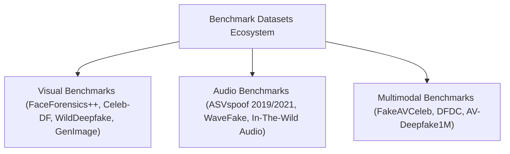

# Global Deepfake Tools, Frameworks & Platform Catalog

**An authoritative directory of open-source repositories, commercial detection engines, forensic frameworks, and research benchmark datasets.**

---

## 1. Open-Source Generative Tools & Synthesis Repositories

| Tool / Framework | Modality | Primary Architecture | Repository / Source | License | Forensic Signatures |
|:---|:---|:---|:---|:---:|:---|
| **DeepFaceLab (DFL)** | Video Face Swap | Dual-Decoder Autoencoder (SAEHD) | [iperov/DeepFaceLab](https://github.com/iperov/DeepFaceLab) | GPL-3.0 | Blending perimeter boundaries, landmark jitter at steep yaw |
| **SimSwap** | Image/Video Swap | ID Injection + Feature Blending | [neuralchen/SimSwap](https://github.com/neuralchen/SimSwap) | CC-BY-NC | Identity leakage under extreme poses, lowered texture resolution |
| **FaceFusion** | Real-Time Swap | ONNX Runtime + InsightFace | [facefusion/facefusion](https://github.com/facefusion/facefusion) | GPL-3.0 | Edge blurring around hairline, uniform skin reflectance |
| **LivePortrait** | Facial Reenactment | Implicit Keypoint Transformer | [KwaiVGI/LivePortrait](https://github.com/KwaiVGI/LivePortrait) | Apache-2.0 | Eye gaze dissociation, ear warping during high-speed rotation |
| **SadTalker** | Audio-Driven Head | ExpNet + PoseVAE + Face3D | [OpenTalker/SadTalker](https://github.com/OpenTalker/SadTalker) | MIT | Rigid neck motion, unnatural eyebrow frequency |
| **Wav2Lip** | Video Lip-Sync | SyncNet-guided U-Net Inpainting | [Rudrabha/Wav2Lip](https://github.com/Rudrabha/Wav2Lip) | MIT | Teeth blurring, temporal smoothing at word transitions |
| **LatentSync** | Audio Lip-Sync | Audio-Conditioned Latent Diffusion | [bytedance/LatentSync](https://github.com/bytedance/LatentSync) | Apache-2.0 | Diffusion residual noise in oral cavity |
| **RVC (Retrieval-based VC)**| Audio Voice Conversion | HuBERT/WavLM + KNN + HiFi-GAN | [RVC-Project/Retrieval-based-Voice-Conversion-WebUI](https://github.com/RVC-Project) | MIT | Pitch jumping artifacts, phase discontinuities in harmonics |
| **XTTS-v2** | Zero-Shot Voice Clone | Tortoise-derived Latent Codec | [coqui-ai/TTS](https://github.com/coqui-ai/TTS) | MPL-2.0 | Micro-prosodic stiffness, loss of breath dynamics |
| **F5-TTS** | Zero-Shot Voice Clone | Flow Matching Non-Autoregressive | [SWivid/F5-TTS](https://github.com/SWivid/F5-TTS) | MIT | High-frequency phase decay above 14 kHz |
| **Wan2.1** | Video Diffusion | 3D Spatio-Temporal DiT | [Wan-Video/Wan2.1](https://github.com/Wan-Video) | Apache-2.0 | Object permanence glitches, fluid dynamic violations |
| **LTX-Video** | Real-Time Video DiT | Spatial-Temporal Transformer | [Lightricks/LTX-Video](https://github.com/Lightricks/LTX-Video) | Apache-2.0 | Subtle temporal flickering, background hallucination |

---

## 2. Open-Source Forensic & Detection Frameworks

| Framework | Domain | Primary Methodology | Repository / Paper Reference | Key Strengths |
|:---|:---|:---|:---|:---|
| **DeepfakeBench** | Visual Benchmark | Comprehensive benchmark of 15+ detection models | [Sensity-AI/DeepfakeBench](https://github.com/Sensity-AI/DeepfakeBench) (Yan et al., NeurIPS 2023) | Unified benchmark harness, zero-leakage evaluation protocols |
| **Face X-Ray** | Visual Blending | Detects blending boundary artifacts between skin patches | [Face X-Ray](https://arxiv.org/abs/2003.00196) (Li et al., CVPR 2020) | Generalizes across unseen face swap generators |
| **LipForensics** | Temporal Dynamics | Spatial-temporal conv net tracking irregular lip articulation | [Sara-Hald/LipForensics](https://github.com/Sara-Hald/LipForensics) (Haliassos et al., CVPR 2021) | Robust to extreme video compression; detects semantic anomalies |
| **DIRE** | Diffusion Attribution | Measures diffusion latent reconstruction error | [ZhendongWang6/DIRE](https://github.com/ZhendongWang6/DIRE) (Wang et al., ICCV 2023) | High detection accuracy on Stable Diffusion, Midjourney, DALL-E |
| **AASIST** | Audio Anti-Spoofing | Spectro-temporal graph attention networks over raw audio | [clovaai/aasist](https://github.com/clovaai/aasist) (Jung et al., ICASSP 2022) | State-of-the-art on ASVspoof 2019 LA benchmark |
| **RawNet2** | Audio Anti-Spoofing | Raw waveform processing via SincNet convolutions | [asvspoof-challenge/2021](https://github.com/eurecom-asp/RawNet2) (Tak et al., 2021) | Bypasses fixed spectrogram transform limitations |
| **PRNU-Python** | Sensor Fingerprint | Computes Camera PRNU correlation over residual noise | [Luca-D/prnu-python](https://github.com/Luca-D/prnu-python) | Hardware-level forensic admissibility in court |

---

## 3. Commercial Detection & Content Verification Platforms

| Platform | Specialization | Target Customers | Modalities Covered | Deployment Form Factor |
|:---|:---|:---|:---|:---|
| **Reality Defender** | Real-Time Deepfake Detection | Financial Institutions, Governments, Media | Video, Audio, Image, Text | Enterprise API, Web App, Zoom/Teams Plugin |
| **Sensity AI** | Threat Intelligence & Media Forensics | Security Teams, KYC Providers, Law Enforcement | Video, Image, Identity Documents | SaaS Platform, REST API |
| **Truepic** | Hardware-Bound C2PA Capture | Photojournalism, Insurance Inspection | Image, Video | Mobile SDK (Truepic Lens), C2PA Signer |
| **Pindrop** | Voice Biometrics & Call Center Anti-Spoofing | Retail Banking, Telecom, Contact Centers | Audio / Telephony Stream | Telecom Network Gateway, Cloud API |
| **Microsoft Video Authenticator**| Temporal Video Forensics | Election Officials, News Organizations | Video, Image | Azure AI Studio, Trusted Partner Access |
| **Deepware Scanner** | Open Forensic Screening | General Public, Journalists | Video | Open Web Scanner, Android App |
| **Hive Moderation** | AI-Generated Content Classification | Social Media Platforms, Trust & Safety | Image, Video, Audio, Text | High-Throughput REST API |

---

## 4. Benchmark Datasets Compendium

### 4.1 Visual Benchmarks
- **FaceForensics++ (FF++) (ICCV 2019):** 1,000 pristine YouTube sequences manipulated with 4 methods (Deepfakes, Face2Face, FaceSwap, NeuralTextures) across 3 compression regimes (Raw/c0, HQ/c23, LQ/c40).
- **Celeb-DF v2 (CVPR 2020):** 5,639 high-definition videos with reduced boundary artifacts and improved color harmony, presenting an advanced generalization challenge.
- **WildDeepfake (ACM MM 2021):** 7,314 real-world internet-harvested deepfake sequences with diverse facial poses, camera motions, and occlusions.
- **GenImage (NeurIPS 2023):** Over 1.3 million images generated across 8 generative models (Stable Diffusion v1.4/v1.5, Midjourney, DALL-E, ADM, VQDM, BigGAN).

### 4.2 Audio Anti-Spoofing Benchmarks
- **ASVspoof 2019 LA (Logical Access):** 121,461 audio files evaluating 19 speech synthesis and voice conversion algorithms.
- **ASVspoof 2021 DF (Deepfake Track):** 600,000+ files processed through lossy VoIP and telephony audio codecs.
- **WaveFake (Interspeech 2021):** 117,984 files across 6 neural vocoders (MelGAN, Parallel WaveGAN, Multi-band MelGAN, HiFi-GAN, WaveGlow) in English and Japanese.
- **In-The-Wild Audio Deepfake (2022):** Real-world audio clips of politicians, celebrities, and business leaders harvested from public social media.

### 4.3 Multimodal Audio-Visual Benchmarks
- **FakeAVCeleb (NeurIPS 2021):** 21,566 video clips systematically partitioned into a **4-quadrant manipulation matrix**:
  - Real Video + Real Audio (RR)
  - Fake Video + Real Audio (FR)
  - Real Video + Fake Audio (RF)
  - Fake Video + Fake Audio (FF)
- **Deepfake Detection Challenge (DFDC) (Facebook/Kaggle 2020):** Over 100,000 clips with diverse lighting conditions, head angles, background noise, and actors.
