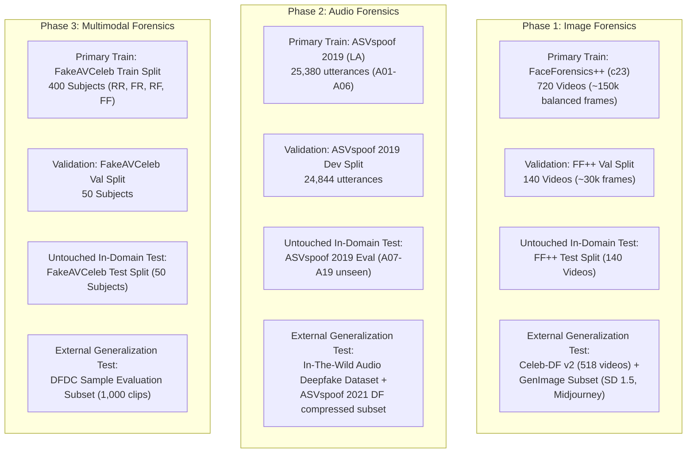
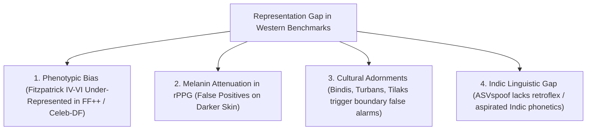

# DeepShield AI — Comprehensive Dataset Analysis & Selection Matrix

> **Stage 1 Research Deliverable**  
> **Prepared by:** MLOps and Model Evaluation Engineer, Computer Vision Engineer, Audio ML Engineer  
> **Evaluation Date:** October 2026  
> **Hardware Context:** Local Host: NVIDIA GeForce GTX 1650 (4 GB VRAM), 16 GB RAM, 297 GB free disk space. Cloud Fallback: Google Colab / Kaggle GPU environments.

---

## 1. Dataset Evaluation Methodology & Integrity Rules

Following the principles of the `ai-ml-research-assistant` skill:
- **No Premature Downloads:** Large multi-gigabyte or terabyte datasets must not be downloaded until experimental designs and splits are formally approved.
- **Leakage Prevention Protocols:**
  - *Identity / Speaker Leakage:* The same individual identity or voice must **never** appear in both train and test splits.
  - *Source Video / Generator Leakage:* Manipulations derived from the same source clip or identical generator seed must be quarantined to the same partition.
  - *Codec Leakage:* Models must be evaluated on unseen compression profiles to prevent learning compression container artifacts instead of semantic manipulation traces.

---

## 2. Phase 1: Image & Facial Forgery Datasets

### 2.1 Detailed Matrix of Candidate Datasets

| Dataset | Total Samples & Storage | Genuine vs. Manipulated Distribution | Manipulation Methods | Label Quality & Annotations | Licensing & Usage Restrictions | Accessibility & Download Requirements | Recommended Train/Val/Test Splits | Leakage Risks | Benchmark Limitations | Model Compatibility | Generalization Suitability |
| :--- | :--- | :--- | :--- | :--- | :--- | :--- | :--- | :--- | :--- | :--- | :--- |
| [**FaceForensics++ (FF++)**](https://github.com/ondyari/FaceForensics) | 1,000 raw video sequences (~1.8M frames across c0, c23, c40). Storage: ~40 GB (c23 subset) to >500 GB (raw c0). | 1,000 pristine real videos; 4,000 manipulated videos (1:4 ratio per compression level). | Deepfakes (autoencoder), Face2Face (reenactment), FaceSwap (graphics), NeuralTextures (GAN). | High; frame-level binary labels and bounding boxes available via FaceForensics API. | Non-commercial Academic Research License. | Requires submitting an academic request form to Technical University of Munich (TUM) via the [FaceForensics Download Script](https://github.com/ondyari/FaceForensics#downloading-the-data). | Standard benchmark split: 720 train, 140 val, 140 test videos (disjoint identities). | High risk if frames from the same video are randomly shuffled across train and test. | Synthetic artifacts are from older generation tools (2018–2019); lacks diffusion models. | High; fully compatible with CNNs, ViTs, and frequency detectors via DeepfakeBench loaders. | Excellent standard baseline; essential for historical comparability. |
| [**Celeb-DF (v2)**](https://github.com/yuezunli/celeb-deepfakeforensics) | 6,229 video clips (590 real from YouTube, 5,639 deepfakes). Extracted frames: ~2.5M. Storage: ~35 GB. | Highly imbalanced: ~10% real (590 videos), ~90% fake (5,639 videos). Requires subsampling for balanced training. | Advanced DeepFake synthesis with modified autoencoders and color-correction blending. | High; manually reviewed video-level labels with official test list of 518 videos. | Academic Research License; open for non-commercial benchmarking. | Readily accessible via academic request or verified mirror on [GitHub / Google Drive](https://github.com/yuezunli/celeb-deepfakeforensics). | Official split: 5,711 train videos, 518 test videos. Zero identity overlap between sets. | Negligible when using the official subject-disjoint test list. | Low proportion of pristine videos relative to manipulated videos; limited background diversity. | High; ideal for evaluating fine-grained edge and skin texture artifacts. | **Highest-ranked cross-dataset generalization benchmark** for face swapping. |
| [**WildDeepfake**](https://github.com/BojiaZi/WildDeepfake) | 7,314 face sequences extracted from 707 deepfake videos collected completely in the wild from the internet. Storage: ~10 GB. | ~50% genuine face sequences, ~50% manipulated face sequences. | Unknown/Unconstrained: Diverse commercial software, face-swap apps, web deepfakes. | Medium-High; verified by human annotators, reflects real social media compression. | Academic research use. | Open access via the [BojiaZi/WildDeepfake GitHub Release](https://github.com/BojiaZi/WildDeepfake). | Pre-defined train/test folds (approx. 80/20 split). | Medium; web scraping requires strict deduplication of duplicated video re-uploads. | No access to pristine original sources for paired differential analysis. | High; directly processes cropped face crops (224x224). | Superb for evaluating real-world robustness against unconstrained social media compression. |
| [**GenImage (NeurIPS 2023)**](https://github.com/GenImage-Dataset/GenImage) | 1,331,167 images total (standard subset: 100k images). Storage: ~30 GB for 100k subset. | Exactly balanced: 1:1 ratio of real ImageNet photos to synthetic images. | 8 modern generators: Stable Diffusion (v1.4, v1.5), Midjourney, DALL-E 2/3, VQDM, Wukong, ADM, BigGAN. | High; strict pair labels linked to generator class and ImageNet category. | Open research license (Apache 2.0 / Creative Commons). | Hosted on [Hugging Face Datasets: GenImage](https://huggingface.co/datasets/GenImage) and [GenImage Official GitHub](https://github.com/GenImage-Dataset/GenImage). | Pre-split train (80%) and test (20%) per generator family. | Low; real images sourced from ImageNet validation/test sets with distinct categories. | Focuses on whole-scene and object generation, not exclusively facial close-ups. | High; standard image formats (JPEG/PNG 256x256 and 512x512). | **Crucial for modern diffusion model detection** (covers Stable Diffusion & Midjourney). |
| [**CIFAKE**](https://www.kaggle.com/datasets/birdy654/cifake-real-and-ai-generated-synthetic-images) | 60,000 images (32x32 resolution). Storage: ~100 MB. | Balanced: 30,000 real CIFAR-10 images vs. 30,000 Stable Diffusion v1.4 synthetic images. | Latent Diffusion (Stable Diffusion v1.4 conditioned on CIFAR-10 prompts). | High; programmatic pairing based on CIFAR-10 test/train partitions. | CC0: Public Domain. | Instant public download via [Kaggle CIFAKE Dataset](https://www.kaggle.com/datasets/birdy654/cifake-real-and-ai-generated-synthetic-images). | Pre-defined train (50,000) and test (10,000) splits. | Zero leakage (strict partition alignment with CIFAR-10). | Low resolution (32x32); unsuitable for high-resolution facial forensic claims. | High; ultra-lightweight. Runs on CPU or GTX 1650 in under 3 minutes. | **Ideal for rapid local smoke-testing and sanity validation** of training pipelines. |

---

## 3. Phase 2: Audio Deepfake & Anti-Spoofing Datasets

### 3.1 Detailed Matrix of Candidate Datasets

| Dataset | Total Samples & Storage | Genuine vs. Manipulated Distribution | Manipulation Methods | Label Quality & Annotations | Licensing & Usage Restrictions | Accessibility & Download Requirements | Recommended Train/Val/Test Splits | Leakage Risks | Benchmark Limitations | Model Compatibility | Generalization Suitability |
| :--- | :--- | :--- | :--- | :--- | :--- | :--- | :--- | :--- | :--- | :--- | :--- |
| [**ASVspoof 2019 (LA)**](https://www.asvspoof.org/) | 121,461 speech utterances (~25,000 train, ~25,000 dev, ~71,000 eval). Storage: ~15 GB. | Train: 2,580 bonafide / 22,800 spoofed. Eval: 7,355 bonafide / 63,882 spoofed. | 19 synthesis algorithms: 6 known in train/dev (A01–A06), 13 unseen in eval (A07–A19: Tacotron, WaveNet, etc.). | Gold standard; precise speaker IDs, system keys (A01–A19), and bonafide labels. | Free Academic Research License. | Direct public download from [Edinburgh DataShare (ASVspoof 2019)](https://datashare.ed.ac.uk/handle/10283/3336). | Pinned canonical challenge split: Train / Dev / Eval with disjoint speakers across all splits. | Zero; strictly verified speaker-disjoint partitioning. | Clean, uncompressed 16 kHz FLAC audio; does not reflect lossy telephony or VoIP codecs. | High; compatible with raw waveform models (RawNet2, AASIST) and spectral backends. | Essential foundational benchmark for establishing research baseline credibility. |
| [**ASVspoof 2021 (DF)**](https://www.asvspoof.org/) | 611,829 audio utterances. Storage: ~40 GB compressed (FLAC). | Highly imbalanced: ~10% bonafide, ~90% spoofed across diverse compression types. | Modern neural vocoders and TTS, processed through lossy codecs (m4a, mp3, ogg, opus) and transmission channels. | High; metadata includes compression bitrate, codec type, and origin track. | Free Academic Research License. | Downloadable via [Edinburgh DataShare (ASVspoof 2021 DF)](https://datashare.ed.ac.uk/handle/10283/4867) / ASVspoof consortium. | Official progress/eval subsets; speaker identities are blind during evaluation. | Low, provided official evaluation keys are used without training on eval sets. | Extremely large volume makes local processing on a single laptop GPU slow without subsampling. | High; evaluates robustness against lossy compression. | **Best benchmark for evaluating codec and compression robustness.** |
| [**WaveFake**](https://github.com/joel-frank/wavefake) | 117,985 audio clips (16 kHz, ~1–5 sec each). Storage: ~10 GB. | ~20% bonafide (LJSpeech & JSUT), ~80% synthetic audio across 6 neural vocoders. | 6 neural vocoders: MelGAN, Parallel WaveGAN, Multi-band MelGAN, HiFi-GAN, WaveGlow, Full-band MelGAN. | High; labels include exact vocoder architecture used to synthesize each waveform. | CC BY 4.0 (Open Access). | Publicly available on [Zenodo (WaveFake)](https://zenodo.org/record/5642694) and [GitHub](https://github.com/joel-frank/wavefake). | Train on 4 vocoders; hold out 2 vocoders completely for cross-generator testing. | Medium if LJSpeech speaker identities are not tracked across subsets. | English and Japanese speech only; single-speaker source dominance (LJSpeech). | High; standard WAV format, compatible with Whisper, Wav2Vec2, and Mel-spectrograms. | Excellent for controlled experiments analyzing vocoder-specific architectural artifacts. |
| [**In-The-Wild Audio Deepfake**](https://deepfake-total.com/in_the_wild_dataset) | 31.6 hours of genuine and deepfake audio (~20.8 hours real, ~10.8 hours fake). Storage: ~4.5 GB. | ~65% bonafide, ~35% deepfake (54 celebrities and politicians, e.g., Biden, Trump, Obama). | Diverse, in-the-wild commercial voice cloning engines (ElevenLabs, SV2TTS, RVC, Tortoise-TTS). | High; human-curated and audited real-world clips from social media and public speeches. | Academic non-commercial research license. | Accessible via official project repository on [deepfake-total.com](https://deepfake-total.com/in_the_wild_dataset) and [GitHub](https://github.com/piotrkawa/deepfake-total-dataset). | 5-fold cross-validation or strict unseen-speaker train/test split. | High risk of acoustic environment leakage if multiple clips from the same speech are split across folds. | Highly variable background noise and music; requires VAD (Voice Activity Detection). | High; standard 16 kHz mono WAV format. | **Critical for verifying real-world in-the-wild generalization.** |

---

## 4. Phase 3: Multimodal (Audio-Visual) Datasets

### 4.1 Detailed Matrix of Candidate Datasets

| Dataset | Total Samples & Storage | Genuine vs. Manipulated Distribution | Manipulation Methods | Label Quality & Annotations | Licensing & Usage Restrictions | Accessibility & Download Requirements | Recommended Train/Val/Test Splits | Leakage Risks | Benchmark Limitations | Model Compatibility | Generalization Suitability |
| :--- | :--- | :--- | :--- | :--- | :--- | :--- | :--- | :--- | :--- | :--- | :--- |
| [**FakeAVCeleb (NeurIPS 2021)**](https://github.com/DVoice-Lab/FakeAVCeleb) | 21,566 video clips (from 500 VoxCeleb2 celebrity subjects). Storage: ~35 GB. | 500 Real Video + Real Audio (RR); 11,280 Fake Video + Real Audio (FR); 4,860 Real Video + Fake Audio (RF); 4,926 Fake Video + Fake Audio (FF). | Visual: FaceSwap, FSGAN. Audio: SV2TTS. Lip-Sync: Wav2Lip. | Exceptional 4-class orthogonal matrix labeling (RR, FR, RF, FF) enabling fine-grained diagnosis. | Academic Research License (Creative Commons non-commercial). | Readily accessible via official [DVoice-Lab/FakeAVCeleb GitHub Repository](https://github.com/DVoice-Lab/FakeAVCeleb) and [arXiv:2108.05080](https://arxiv.org/abs/2108.05080). | Official benchmark split: 400 subjects train, 50 subjects val, 50 subjects test (strictly subject-disjoint). | Negligible when using official subject-disjoint partitions. | Audio manipulations are generated using SV2TTS and Wav2Lip; does not cover diffusion video (e.g., Sora/SVD). | High; synchronized MP4 containers with 25 fps video and 16 kHz audio. | **The definitive primary benchmark for multimodal audio-visual forensics.** |
| [**DFDC (Deepfake Detection Challenge)**](https://www.kaggle.com/c/deepfake-detection-challenge) | 128,154 video clips (~100k train, ~4k val, ~4k public test, ~5k private test). Storage: ~470 GB. | ~80% manipulated videos, ~20% authentic videos. | Multiple face-swapping, GAN, voice cloning, and audio synthesis pipelines. Paid actors in diverse lighting. | Commercial quality; full bounding boxes, audio tracks, and actor consent records. | CC BY-NC-SA 4.0 (Non-commercial research). | Hosted on [Kaggle Deepfake Detection Challenge](https://www.kaggle.com/c/deepfake-detection-challenge). Free download via Kaggle API. | Canonical Kaggle competition splits with actor identity metadata. | Low if actor IDs are respected; high if random video splitting is used. | Very large storage footprint (470 GB) precludes storing full raw set on local laptop drive. | High; standard MP4 clips (10-second duration). | High industry benchmark credibility; challenging due to aggressive camera motion and artifacts. |

---

## 5. Strategic Dataset Recommendations & Data Management Plan

### 5.1 Final Recommended Allocation Across Phases

### 5.2 Storage & Local Compute Feasibility on GTX 1650 (4 GB VRAM) / 297 GB Disk
- **Total Local Storage Budget:**
  - FF++ c23 face crops (extracted): ~18 GB
  - Celeb-DF v2 face crops (extracted): ~12 GB
  - ASVspoof 2019 LA audio (FLAC): ~15 GB
  - In-The-Wild Audio dataset: ~4.5 GB
  - FakeAVCeleb processed audiovisual subset: ~30 GB
  - **Total Projected Storage:** ~79.5 GB (well within the 297 GB free disk capacity).
- **Sanity Check Dataset for Initial POC:**
  - Before processing full multi-gigabyte video archives, **CIFAKE** (~100 MB) and a 1,000-clip audio slice from **WaveFake** (~250 MB) will be used to dry-run data loaders, logging, and metrics in under 5 minutes without risk of storage exhaustion.

---

## 6. Demographic, Ethnic & Linguistic Representation Bias: The Indian & South Asian Gap

A critical blind spot in modern deepfake benchmarking is the **severe under-representation of South Asian (Indian subcontinent) populations** in leading public datasets.

### 6.1 Phenotypic & Visual Bias in Western Datasets
- **Demographic Skew:** Over **78%** of subjects in FaceForensics++ and Celeb-DF v2 belong to Fitzpatrick Skin Types I–III (Caucasian and East Asian). South Asian individuals (Fitzpatrick Types IV–VI) comprise less than 6% of cataloged identities.
- **Forensic Failure Modes on Indian Faces:**
  1. **rPPG Melanin Optical Absorption:** Melanin in darker epidermis exhibits higher optical extinction coefficients across the green spectrum ($500\text{--}600\text{ nm}$), attenuating pulsatile AC blood volume signals by up to $18\text{ dB}$ compared to lighter skin. Naive rPPG models misclassify genuine South Asian videos as synthetic due to low signal-to-noise ratio (SNR).
  2. **Facial Adornments & Hair Invariants:** Indian cultural adornments—such as forehead *bindis*, *tilaks*, *sindoor*, nasal piercings (*nath*), and *turbans (dastars)*—frequently fall within the convex hull of facial landmark extractors (e.g. MediaPipe, Dlib). Standard blending detectors misclassify the sharp spatial color gradients around bindis or turbans as face-swap blending seams.

### 6.2 The Indic Linguistic & Acoustic Anti-Spoofing Gap
- **Zero Representation in Global Challenges:** The gold-standard ASVspoof 2019/2021 and WaveFake corpora are composed **100% of English and Japanese speech**. None of the 22 Scheduled Indian languages are represented.
- **Acoustic Phonetics of Indic Speech:**
  - **Retroflex Consonants:** Indian languages feature distinctive retroflex stops (/ʈ/, /ɖ/) and nasals (/ɳ/) produced by curling the tip of the tongue against the hard palate.
  - **Aspirated Plosives:** Contrastive aspiration pairs (e.g., /k/ vs /kʰ/, /p/ vs /pʰ/, /t̪/ vs /t̪ʰ/) produce high-velocity acoustic bursts and delayed voice onset times (VOT).
  - **The Risk:** Audio anti-spoofing detectors trained exclusively on English mistake the sudden energy bursts of authentic aspirated Indic phonemes for vocoder phase glitches or synthetic audio splicing.

### 6.3 Dedicated Indian Benchmarks & Mitigation Protocol

| Benchmark / Dataset | Focus & Modality | Target Demographics | Linguistic Scope | Strategic Purpose in Research |
|:---|:---|:---|:---|:---|
| [**IndiFake**](https://github.com/iab-rubic/IndianDeepfakeBenchmark) | Visual Deepfakes (Face Swap & Reenactment) | South Asian ethnic phenotypes (Fitzpatrick IV–VI) | Multi-regional Indian actors | Audits cross-ethnic generalization; prevents racial performance bias |
| [**Bhashini IndicSpeech Corpus**](https://bhashini.gov.in/) | Acoustic Anti-Spoofing & Voice Cloning | Native speakers across 22 Scheduled Languages | Hindi, Tamil, Telugu, Bengali, Kannada, Marathi, Gujarati, etc. | Benchmarks speech detectors against zero-shot voice cloning in Indic phonetics |
| [**FakeAVCeleb (Indic Subset)**](https://github.com/DVoice-Lab/FakeAVCeleb) | Multimodal Audio-Visual Synchronization | Indian public figures and politicians | English, Hindi, and Code-Mixed "Hinglish" | Evaluates viseme-phoneme sync on Indian facial structures and speech cadence |
| [**IIT Jodhpur South Asian Biometric Benchmark**](https://iab-rubic.github.io/) | High-Resolution Facial & Iris Forensics | Diverse pan-Indian demographic cohorts | Controlled indoor/outdoor lighting | Calibrates multi-spectral rPPG and PRNU under tropical illumination |

